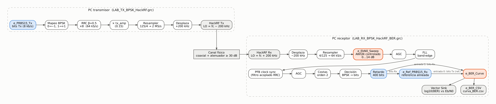

# Telemetría industrial con BPSK sobre HackRF One

**Proyecto final de Comunicaciones II (27145) — Escuela E3T, Universidad Industrial de Santander**
Luis Arley Martínez Caballero · Johan Sebastián Gómez Hernández

Blog del proyecto (GitHub Pages): **https://luisarleym.github.io/ComII-BPSK-Telemetria-HackRF/**

| Entrada del blog | Contenido |
|---|---|
| [Inicio](docs/index.md) | Resumen, arquitectura y cómo reproducir |
| [1. Escenario S1 y simulación con impulsos](docs/01-escenario-beta.md) | Ficha del escenario, GRC con impulsos 0.3/0.6/1.0, PSD, constelación, tiempo, BPSK vs BFSK |
| [2. Del simulador al HackRF One](docs/02-hackrf.md) | Osmocom Sink/Source, 64 kS/s ↔ 2 MS/s, LO desplazado, receptor, preguntas de investigación |
| [3. Medición BER vs Eb/N0](docs/03-ber.md) | Integración de `e_EbN0_Sweep` y `e_BER_Curve`, alineación Tx/Rx, curva simulada, procedimiento experimental |
| [Bitácora](docs/bitacora.md) | Registro de actividades y problemas |



## Parámetros del sistema

| | Fase beta (simulación) | Hardware y BER |
|---|---|---|
| Modulación | BPSK `(-1+0j, 1+0j)` | BPSK `(-1+0j, 1+0j)` |
| Rs / Rb | 32 kbaud / 32 kb/s | 8 kbaud / 8 kb/s |
| Sps / fs | 8 / 256 kS/s | 8 / 64 kS/s (bb_rate) |
| Pulso | Rectangular | RRC β = 0.5 |
| Radio | — | HackRF One, 2 MS/s (125/4), fc = 960 MHz, LO ±200 kHz |
| Barrido BER | — | 0–14 dB, paso 1 dB, 100 000 bits/punto, guarda 1000, delay_bits 0, lat_comp 400 |

## Contenido

```
grc/fase2_simulacion/   Enlace_Beta_Impulsivo_BPSK.grc, Enlace_Beta_Impulsivo_BFSK.grc
grc/fase3_hackrf/       LAB_TX_BPSK_HackRF.grc, LAB_RX_BPSK_HackRF.grc
grc/fase4_ber/          LAB_RX_BPSK_HackRF_BER.grc (laboratorio), SIM_LAZO_BPSK_BER.grc (simulación)
grc/instrumentacion/    e_EbN0_Sweep.py, e_BER_Curve.py*, e_BER_CSV.py*, e_PRBS15_Tx.py, e_Ref_PRBS15_Rx.py,
                        plantilla BER_SDR_INSTRUMENTACION_BASE.grc y README del curso
resultados/simulacion/  curva_BER_simulacion.csv, conteos, condición limpia, análisis impulsivo, registro
resultados/experimental/ curva_BER.csv del laboratorio (pendiente)
scripts/                ejecutar_y_capturar.py, analizar_curva_BER.py, analisis_impulsivo.py, validar_instrumento_numpy.py
```

\* `e_BER_Curve.py` y `e_BER_CSV.py` llevan una corrección mínima de compatibilidad con GNU Radio 3.10 (clase base `gr.decim_block` y uso de `__file__`), explicada en [3. BER](docs/03-ber.md#36-problemas-encontrados-en-la-instrumentación-y-cómo-se-resolvieron). El algoritmo de medición no se modificó.

## Reproducir

- Requisitos: [radioconda](https://github.com/ryanvolz/radioconda) (probado con GNU Radio 3.10.12.0, Python 3.12.9, Windows).
- Simulaciones y capturas: `EJECUTAR_SIMULACIONES.bat` o `python scripts/ejecutar_y_capturar.py`.
- Laboratorio: `LAB_TX_BPSK_HackRF.grc` en el PC transmisor y `LAB_RX_BPSK_HackRF_BER.grc` en el receptor, por cable con ≥ 30 dB de atenuación. Transmitir solo en enlace confinado o en la frecuencia autorizada por el docente.
- Análisis: `python scripts/analizar_curva_BER.py`.
