<script>MathJax={tex:{inlineMath:[['$','$'],['\\(','\\)']]}};</script>
<script async src="https://cdn.jsdelivr.net/npm/mathjax@3/es5/tex-chtml.js"></script>

[← Inicio](index.md) · **1. Escenario** · [2. HackRF](02-hackrf.md) · [3. BER](03-ber.md) · [Bitácora](bitacora.md)

# 1. Escenario S1 y simulación con perturbación impulsiva

## 1.1 Ficha del escenario

Una máquina envía telemetría de estado. El problema no es aumentar la tasa, sino mantener una señal reconocible cuando aparecen perturbaciones eléctricas breves (conmutación de contactores, arranque de motores, descargas). En la versión beta se trabaja en banda base y la perturbación se modela como un tren de impulsos periódico y reproducible.

| Campo | Valor |
|---|---|
| Escenario | S1 — Telemetría industrial, perturbación impulsiva controlada |
| Modulación | BPSK, mapeo `(-1+0j, 1+0j)` (bit 0 → −1, bit 1 → +1) |
| Dificultad / prueba principal | Intermedio / **Media** |
| Rs | 32 ksym/s |
| Rb | 32 kb/s (1 bit por símbolo) |
| Sps | 8 muestras por símbolo |
| fs | Rs·Sps = 256 kS/s |
| Pulso | Rectangular de 8 muestras (GRC base) |
| Ancho de banda | ≈ 64 kHz entre primeros nulos (pulso rectangular); 43.2 kHz si se usara RRC con β = 0.35 |
| Centro | 0 Hz (banda base simulada) |
| Ruido base | `noise_amp = 0.10` → potencia de ruido complejo 0.01 |
| Perturbación | Impulso real de amplitud A cada 256 muestras (1 ms, 1 kHz de repetición) |
| Eb/N0 equivalente del ruido base | $\frac{E_b}{N_0}=\frac{P_s/R_b}{P_n/f_s}=\frac{1/32000}{0.01/256000}=800 \Rightarrow 29.0\ \text{dB}$ |

Con 29 dB de Eb/N0 el AWGN por sí solo prácticamente no produce errores; por eso este escenario aísla el efecto del impulso.

## 1.2 Flujograma construido

Archivo: [`grc/fase2_simulacion/Enlace_Beta_Impulsivo_BPSK.grc`](https://github.com/LuisArleyM/ComII-BPSK-Telemetria-HackRF/blob/main/grc/fase2_simulacion/Enlace_Beta_Impulsivo_BPSK.grc). Conserva la cadena del GRC base y añade la perturbación **después** del ruido, como pide la guía.

```
Random Source (0/1) → Pack K Bits (8) → Packed to Unpacked (1 bit) → Chunks to Symbols (±1)
   → Interpolating FIR (pulso rectangular, ×8) → Throttle (256 kS/s)
   → Add #1 (+ Noise Source, noise_amp) → Add #2 (+ Vector Source [0j]*255 + [A_imp]) → QT GUI (tiempo, PSD, constelación)
```

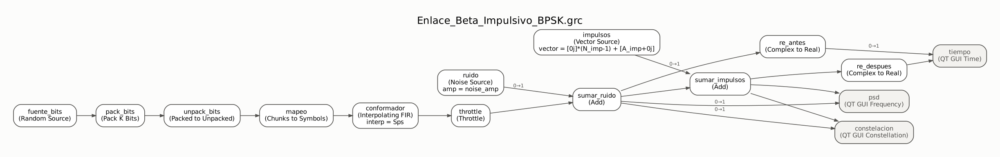

*Flujograma dibujado directamente a partir del archivo .grc (bloques y conexiones reales).*

| Bloque | Qué genera / hace |
|---|---|
| Random Source → Pack K Bits → Packed to Unpacked | Bits aleatorios 0/1 agrupados en símbolos de `bps = 1` bit |
| Chunks to Symbols | Mapeo BPSK a −1 / +1 |
| Interpolating FIR Filter | Inserta 7 ceros entre símbolos y filtra con `[1]*8`: pulso rectangular de 8 muestras |
| Throttle | Limita la simulación a 256 kS/s (solo en simulación) |
| Noise Source + Add #1 | AWGN complejo con desviación total `noise_amp` |
| Vector Source + Add #2 | Tren de impulsos: 255 ceros y un valor `A_imp`, repetido. La suma va después del ruido |
| `Complex to Real` + Time Sink | Parte real antes y después de los impulsos (4 ms en pantalla = 4 impulsos) |
| Frequency Sink | PSD de la señal con impulsos y de la referencia (FFT 4096, promedio 0.05) |
| Constellation Sink | Muestras sobremuestreadas en el plano I-Q |

**Rs, Sps y samp_rate.** Rs es la cantidad de símbolos por segundo que lleva la información; Sps es cuántas muestras representan cada símbolo; samp_rate = Rs·Sps es la tasa a la que realmente corren los bloques. Con 256 kS/s, el periodo del impulso (256 muestras) equivale a 1 ms, es decir, un impulso cada 32 símbolos y siempre en la misma posición dentro del símbolo, porque 256 es múltiplo de 8.

## 1.3 Pruebas obligatorias

| Prueba | `noise_amp` | `A_imp` | Periodo | Potencia media del impulso (A²/256) | Señal/impulso | Pico del impulso / σ del ruido (por componente) |
|---|---|---|---|---|---|---|
| Referencia | 0.10 | 0.0 | — | 0 | ∞ | — |
| Suave | 0.10 | 0.3 | 256 muestras | 3.5·10⁻⁴ | 34.5 dB | 4.2 σ |
| **Media (principal)** | 0.10 | **0.6** | 256 muestras | 1.4·10⁻³ | 28.5 dB | 8.5 σ |
| Fuerte | 0.10 | 1.0 | 256 muestras | 3.9·10⁻³ | 24.1 dB | 14 σ |

Rs = 32 ksym/s, Sps = 8 y samp_rate = 256 kS/s no se cambiaron en ninguna prueba; solo se varió `A_imp`, la variable que autoriza el escenario.

### Capturas BPSK (GNU Radio 3.10.12)

| Prueba | Tiempo (parte real, 4 ms) | PSD | Constelación |
|---|---|---|---|
| Referencia | 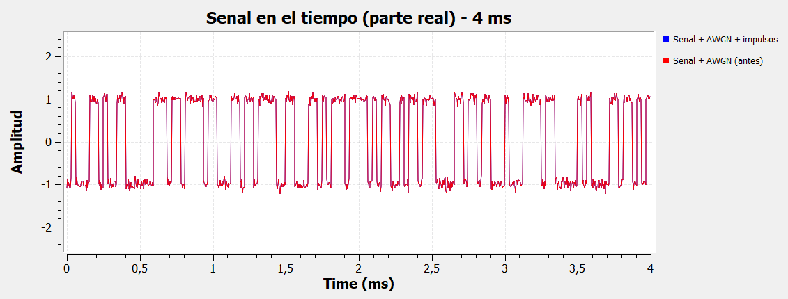 | 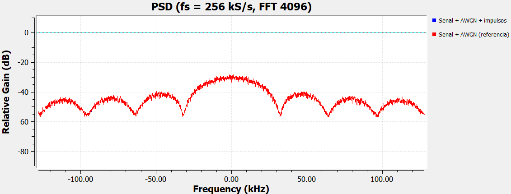 |  |
| Suave (0.3) | 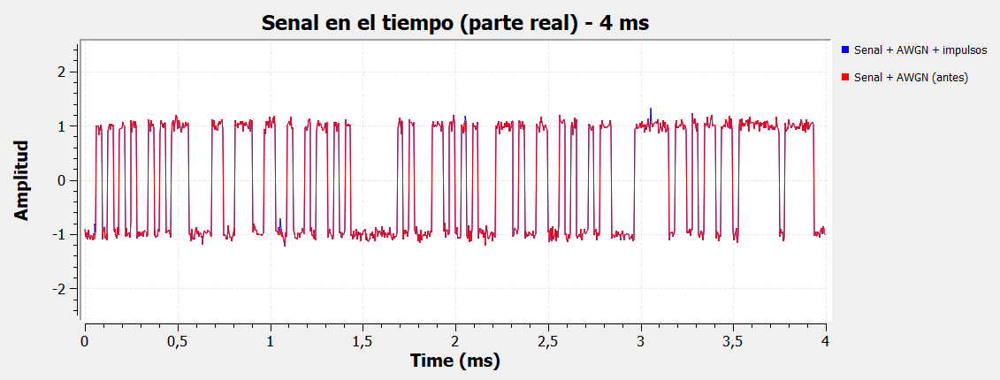 | 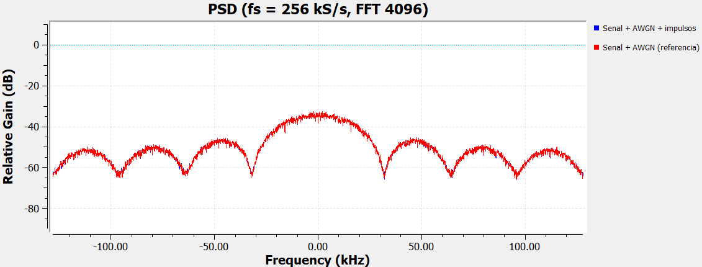 |  |
| Media (0.6) | 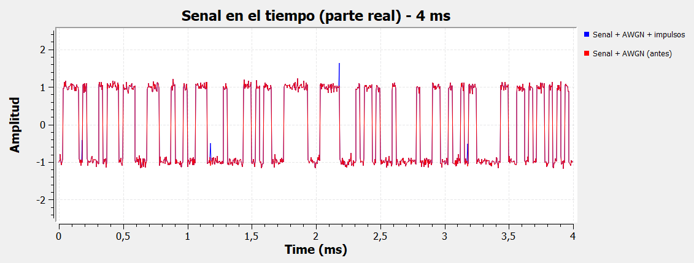 | 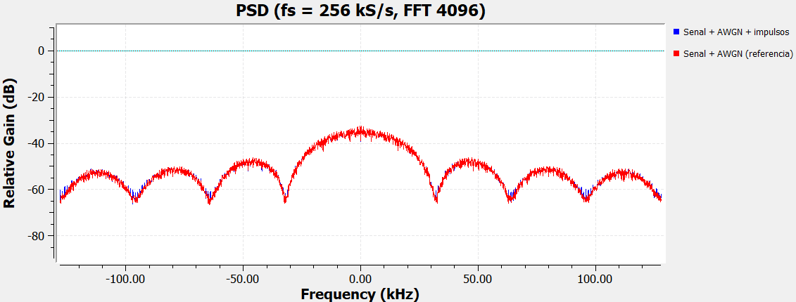 | 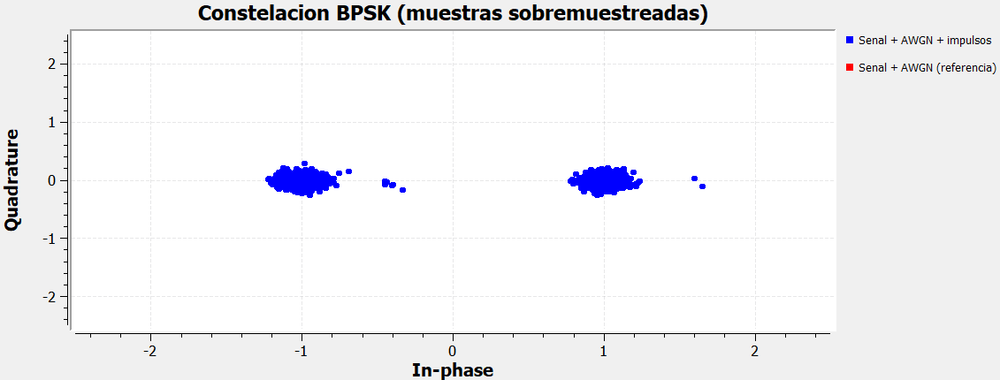 |
| Fuerte (1.0) | 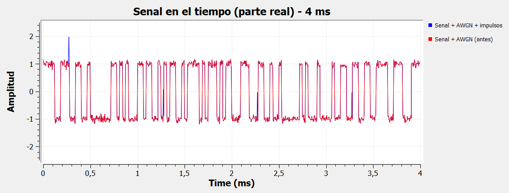 | 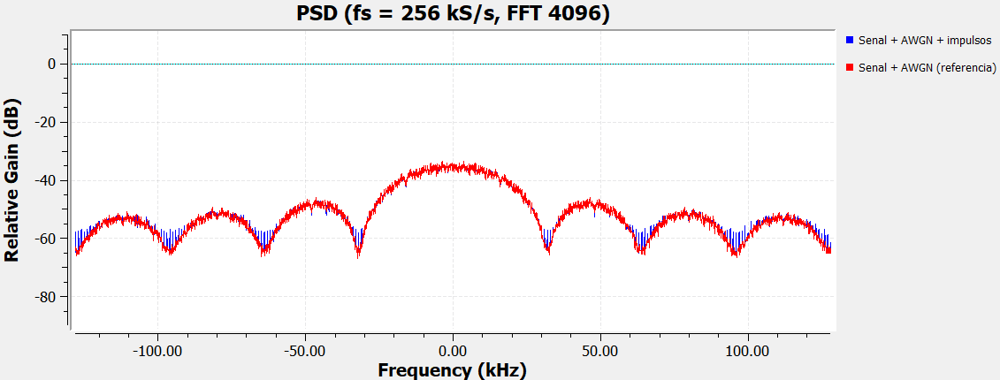 |  |

**Prueba principal (Media, A = 0.6) en tamaño completo:**


### Qué cambió en cada ejecución y por qué

- **Referencia.** Señal BPSK de pulsos rectangulares más AWGN débil. En el tiempo se ven los niveles ±1 con un ruido pequeño; en la PSD aparece el lóbulo principal tipo sinc² con nulos cada 32 kHz (múltiplos de Rs); la constelación son dos nubes compactas en ±1. Es la captura base contra la que se comparan las demás.
- **Suave (A = 0.3).** Cada milisegundo aparece una espiga de 0.3 sobre la parte real. Equivale a unas 4 desviaciones estándar del ruido, así que se distingue, pero cuesta separarla de los picos ocasionales del AWGN. En la PSD el cambio es casi imperceptible (+0.15 dB en el piso) y en la constelación aparecen unos pocos puntos desplazados +0.3 sobre el eje real.
- **Media (A = 0.6).** Las espigas son evidentes (8.5 σ): sobre el nivel +1 la muestra salta a 1.6 y sobre −1 sube a −0.4, siempre del mismo lado porque el impulso es real y positivo. En la constelación se forma un grupo de puntos atípicos a la derecha de cada nube. Con la FFT de 4096 puntos (resolución de 62.5 Hz) el tren de impulsos aparece como un peine de líneas cada 1 kHz que sobresale en los lóbulos laterales y rellena los nulos del sinc²; en promedio el piso sube ≈ 0.6 dB.
- **Fuerte (A = 1.0).** Sobre un símbolo −1 la muestra afectada queda en ≈ 0, justo en la frontera de decisión. La constelación muestra puntos atípicos cerca de 2 (impulso sobre un +1) y de 0 (impulso sobre un −1), y en la PSD el peine de líneas espaciadas 1 kHz se ve con claridad en los lóbulos laterales y en los nulos (≈ +1.4 dB de piso promedio). Es la prueba de estrés: a partir de aquí un receptor que decida con una sola muestra empieza a equivocarse.

## 1.4 Respuestas a las preguntas del escenario

**¿El impulso aparece claramente en el dominio del tiempo?** Sí, desde la prueba media. Es una espiga de una sola muestra (3.9 µs) que se repite exactamente cada 1 ms, solo en la componente en fase. Con A = 0.3 se ve, pero se confunde con picos de ruido; con 0.6 y 1.0 es inconfundible. El dominio del tiempo es la mejor representación para detectar este tipo de perturbación, porque la energía del impulso está concentrada en el tiempo y dispersa en frecuencia.

**¿Cómo cambia el piso o los componentes de la PSD?** Un tren de impulsos de periodo T = 1 ms es, en frecuencia, un peine de líneas cada 1/T = 1 kHz con envolvente plana en toda la banda de ±128 kHz, de potencia total A²/256. Esa potencia se suma al ruido blanco y levanta el piso en

$$\Delta_{piso} = 10\log_{10}\left(1+\frac{A^2/256}{\sigma_n^2}\right),\qquad \sigma_n^2 = 0.01$$

es decir +0.15 dB, +0.57 dB y +1.43 dB para 0.3, 0.6 y 1.0. El modelo numérico ([`scripts/analisis_impulsivo.py`](https://github.com/LuisArleyM/ComII-BPSK-Telemetria-HackRF/blob/main/scripts/analisis_impulsivo.py)) midió +0.16, +0.59 y +1.46 dB. El lóbulo principal de la BPSK no cambia, porque la señal tiene 24–35 dB más potencia que el tren de impulsos. El cambio solo se nota donde la señal es débil: en los nulos del sinc², que se rellenan, y en los bordes de la banda.

**¿BPSK y BFSK reaccionan de la misma forma visualmente?** No. Para responderlo construimos la misma prueba con BFSK de fase continua: Rb = 32 kb/s, desviación ±16 kHz y los mismos impulsos ([`Enlace_Beta_Impulsivo_BFSK.grc`](https://github.com/LuisArleyM/ComII-BPSK-Telemetria-HackRF/blob/main/grc/fase2_simulacion/Enlace_Beta_Impulsivo_BFSK.grc)).

| Prueba | Frecuencia instantánea (1 = +16 kHz) | PSD BFSK | Plano I-Q |
|---|---|---|---|
| Referencia | 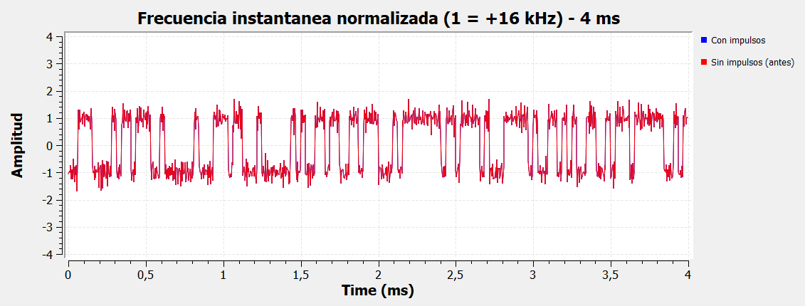 | 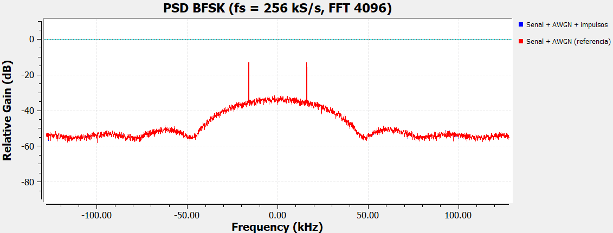 | 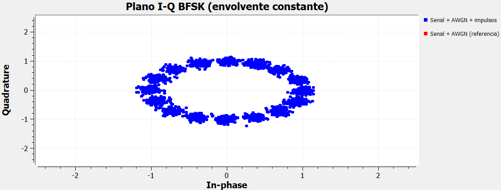 |
| Media (0.6) | 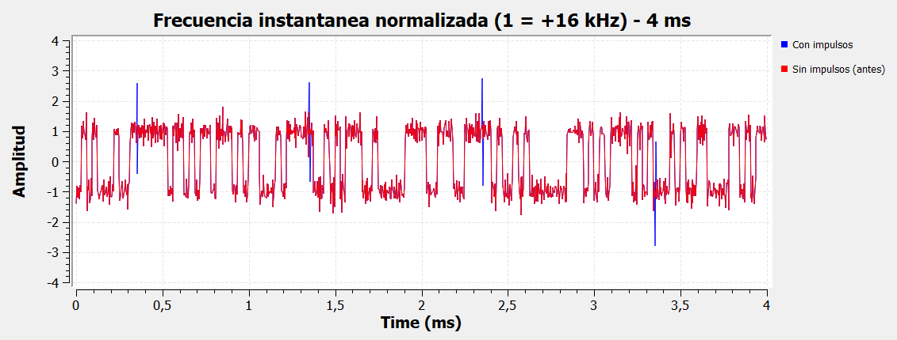 | 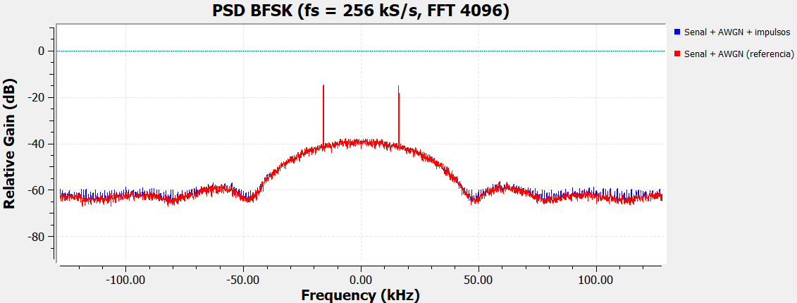 | 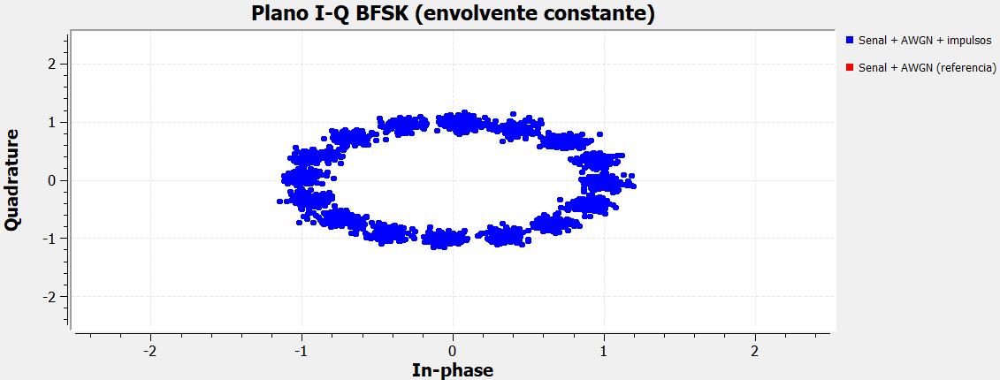 |
| Fuerte (1.0) | 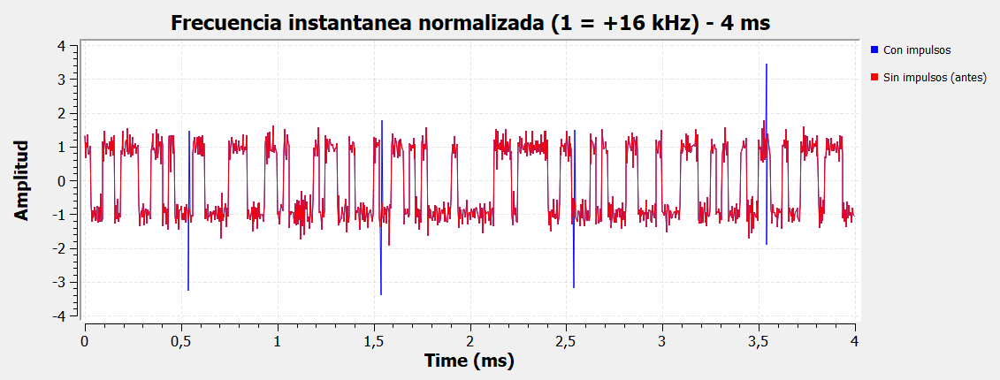 | 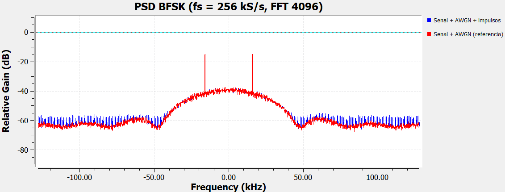 | 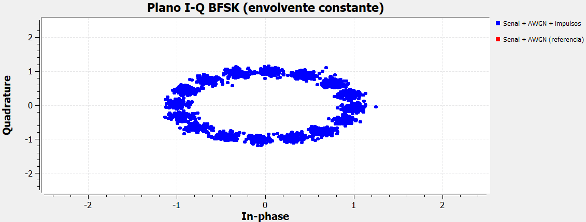 |

- En **BPSK** el impulso es una perturbación de **amplitud**: suma A a la componente I. Se ve como una espiga del mismo tamaño que el impulso y, en la constelación, como puntos desplazados horizontalmente.
- En **BFSK** la información está en la **frecuencia** y la envolvente es constante (en el plano I-Q la señal es un círculo de radio 1). El impulso cambia de golpe la **fase** de la muestra, y el discriminador (Quadrature Demod) convierte ese salto en un par de "chasquidos" de signo opuesto en la frecuencia instantánea: un pico al entrar y otro al salir. Con A = 1.0 el pico típico llega a unas 3 veces la desviación nominal, mucho más llamativo que en BPSK. En el plano I-Q aparecen puntos fuera del círculo.
- En ambos casos la PSD solo muestra el levantamiento del piso; los lóbulos de BFSK están en ±16 kHz.

## 1.5 Extensión: ¿cuántos errores produce el impulso?

La guía beta no exige BER, pero la pregunta natural para telemetría es si los impulsos producen errores. Con el mismo modelo en Python (2·10⁶ símbolos por caso) se comparan tres detectores:

| Prueba | BPSK, 1 muestra por símbolo (peor caso: el muestreo coincide con el impulso) | BPSK con filtro acoplado (integrar y descargar) | BFSK, discriminador promediado en el símbolo |
|---|---|---|---|
| Referencia | 0 | 0 | 0 |
| Suave (0.3) | 0 | 0 | 0 |
| Media (0.6) | 0 | 0 | 0 |
| Fuerte (1.0) | **7.8·10⁻³** | 0 | 0 |

Datos: [`resultados/simulacion/analisis_impulsivo.csv`](https://github.com/LuisArleyM/ComII-BPSK-Telemetria-HackRF/blob/main/resultados/simulacion/analisis_impulsivo.csv).

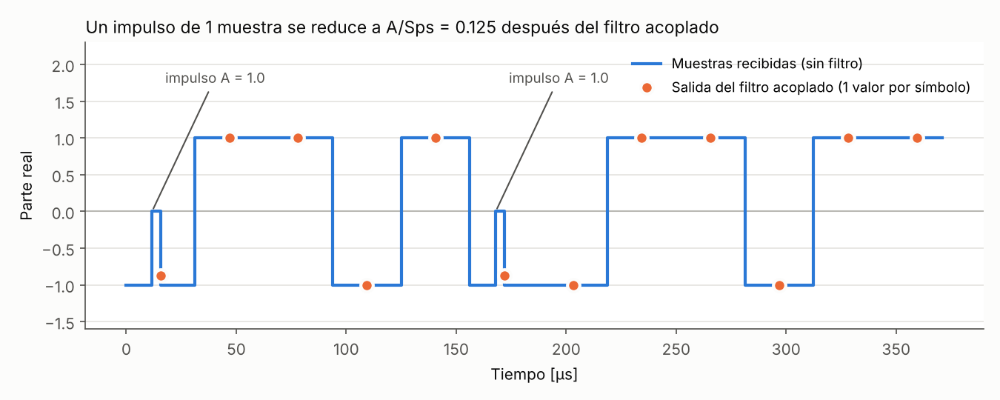

La BER de 7.8·10⁻³ se explica sin simulación: uno de cada 32 símbolos recibe el impulso; si ese símbolo es −1 (probabilidad 1/2) queda en 0 + ruido y se decide mal la mitad de las veces, así que BER = 1/32 · 1/2 · 1/2 = 1/128 ≈ 7.8·10⁻³. El **filtro acoplado** promedia las 8 muestras del símbolo y reduce el impulso a A/8 = 0.125: el margen frente a la decisión sigue siendo 0.875 y no hay errores. Para telemetría industrial, el filtrado acoplado (o RRC en el receptor) es la primera defensa contra perturbaciones impulsivas cortas, y en el diseño de hardware lo usamos: el receptor de las fases 3 y 4 decide después del filtro acoplado RRC del bloque *Polyphase Clock Sync*.

**Conclusión de la fase beta.** El impulso es muy visible en el tiempo, casi invisible en la PSD (+0.15 a +1.4 dB de piso) y, en BPSK, solo produce errores cuando un receptor sin filtrar decide con una sola muestra. Las representaciones elegidas (tiempo para detectar, PSD para cuantificar la potencia, constelación para ver el efecto sobre la decisión) son coherentes con lo que cada una puede mostrar.

---
[← Inicio](index.md) · [Siguiente: 2. Del simulador al HackRF One →](02-hackrf.md)
