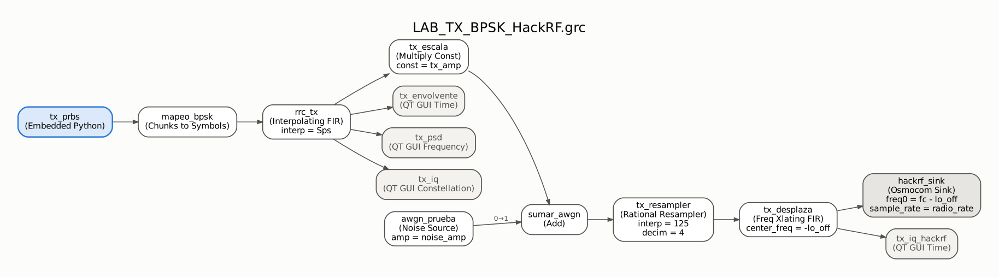
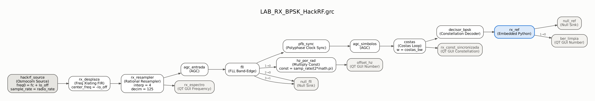
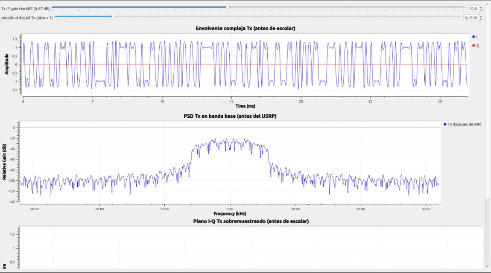
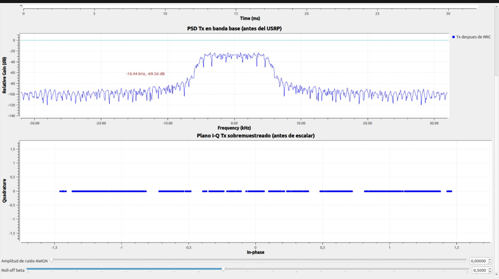
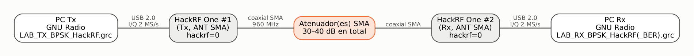
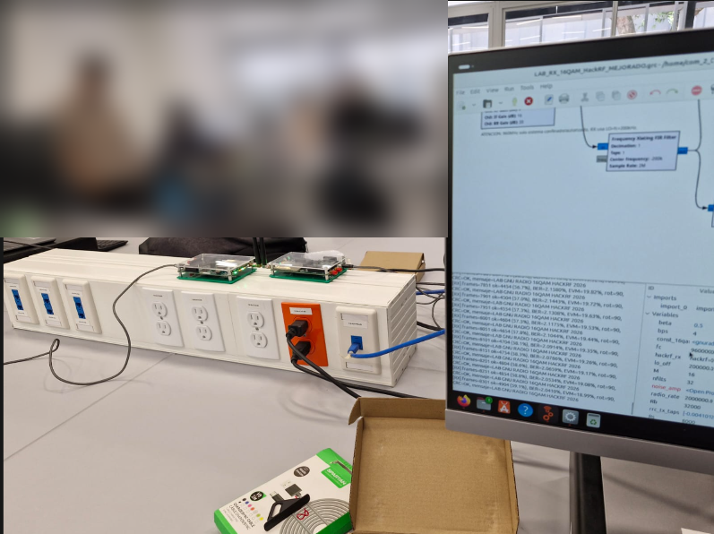
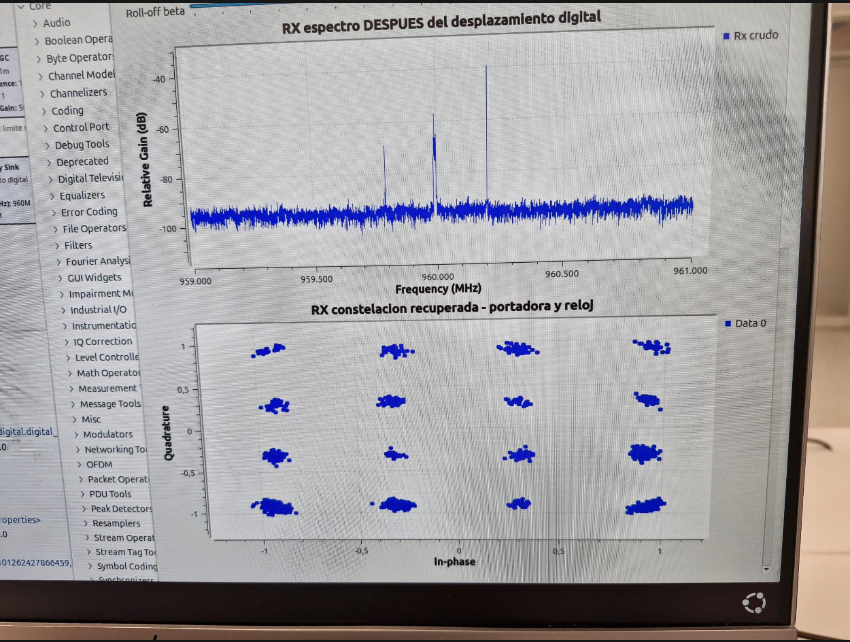
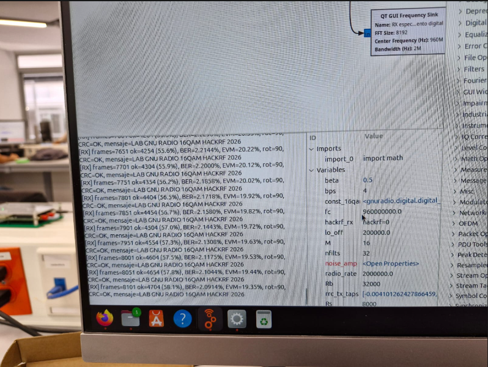

[← Inicio](index.md) · [1. Escenario](01-escenario-beta.md) · **2. HackRF** · [3. BER](03-ber.md) · [Bitácora](bitacora.md)

# 2. Del simulador al HackRF One (Fase 3)

En la simulación el bloque *Channel Model* representaba el medio. Ahora ese papel lo cumplen dos HackRF One y un cable coaxial: el transmisor digital entrega muestras I/Q a un *Osmocom Sink* y, del otro lado, un *Osmocom Source* entrega I/Q al receptor digital. Conservamos los flujogramas simulados y creamos copias específicas para hardware.

| Archivo | Uso |
|---|---|
| [`LAB_TX_BPSK_HackRF.grc`](https://github.com/LuisArleyM/ComII-BPSK-Telemetria-HackRF/blob/main/grc/fase3_hackrf/LAB_TX_BPSK_HackRF.grc) | PC transmisor: PRBS-15 → BPSK → RRC → 2 MS/s → HackRF |
| [`LAB_RX_BPSK_HackRF.grc`](https://github.com/LuisArleyM/ComII-BPSK-Telemetria-HackRF/blob/main/grc/fase3_hackrf/LAB_RX_BPSK_HackRF.grc) | PC receptor: HackRF → 64 kS/s → AGC, FLL, reloj, Costas → bits, con BER en condición limpia |

*Flujogramas dibujados a partir de los .grc (bloques y conexiones reales; en azul, los bloques propios del grupo).*

Los dos archivos compilan sin errores con `grcc` de GNU Radio 3.10.12.0 (registro en [`resultados/simulacion/registro_ejecucion.txt`](https://github.com/LuisArleyM/ComII-BPSK-Telemetria-HackRF/blob/main/resultados/simulacion/registro_ejecucion.txt)).

## 2.1 Parámetros de diseño que pasan a hardware

| Parámetro | Valor | Pertenece a |
|---|---|---|
| Modulación / mapeo | BPSK, bit 0 → −1, bit 1 → +1 | Diseño de comunicaciones |
| Rs | 8 kbaud | Diseño de comunicaciones |
| Rb | Rs·log2(2) = 8 kb/s | Diseño de comunicaciones |
| Sps | 8 | Diseño de comunicaciones |
| bb_rate | Rs·Sps = 64 kS/s | Diseño de comunicaciones |
| Pulso | RRC, β = 0.5, 11 símbolos (88 coeficientes) | Diseño de comunicaciones |
| Ancho de banda ocupado | Rs(1+β) = 12 kHz (±6 kHz) | Diseño de comunicaciones |
| Fuente de bits | PRBS-15 conocida (x¹⁵ + x¹⁴ + 1) | Diseño / instrumentación |
| radio_rate | 2 MS/s | Interfaz de hardware |
| fc | 960 MHz (enlace confinado por cable o frecuencia autorizada por el docente) | Interfaz de hardware |
| Desplazamiento del LO | 200 kHz | Interfaz de hardware |
| Ganancias, ancho de banda RF, argumentos del dispositivo | ver tablas | Interfaz de hardware |

Las capturas que tomamos en clase del transmisor BPSK confirman esos valores: la envolvente solo tiene componente I (Q = 0), la PSD ocupa ±6 kHz dentro de los ±32 kHz de la banda de 64 kS/s y el plano I-Q sobremuestreado queda sobre el eje real.

| Envolvente y PSD del Tx (clase) | PSD y plano I-Q del Tx (clase) |
|---|---|
|  |  |

**¿Cambió Rs?** Sí: en la fase beta Rs = 32 kbaud y en hardware Rs = 8 kbaud. No fue para "hacer que el radio acepte la tasa": 256 kS/s también se lleva a 2 MS/s con la razón 125/16. El cambio pertenece a la aplicación. La telemetría de estado necesita pocos kb/s (el escenario dice explícitamente que el problema no es la tasa), y bajar Rs 4 veces aumenta la energía por bit 6 dB para la misma potencia y reduce el ancho de banda de ruido a 12 kHz. Además coincide con la plantilla de laboratorio usada en clase. La razón entre Rs y fs (Sps = 8) se conservó.

## 2.2 Tasa de banda base vs. tasa del radio

El HackRF One trabaja con tasas I/Q de 2 a 20 MS/s; 64 kS/s no es una tasa válida para el radio. La adaptación se hace con *Rational Resampler*:

$$\text{radio\_rate} = \text{bb\_rate}\cdot\frac{\text{interp}}{\text{decim}} = 64\,000\cdot\frac{125}{4} = 2\,000\,000\ \text{S/s}$$

En recepción se aplica la inversa (4/125) **antes** del receptor digital, que fue diseñado para 64 kS/s. Se eligió el mínimo recomendado de 2 MS/s porque la señal solo ocupa 12 kHz: más tasa solo añade carga de USB y de CPU.

| Pregunta obligatoria | Respuesta |
|---|---|
| ¿Tasa de banda base de la simulación? | 64 kS/s (Rs = 8 kbaud × 8 Sps) |
| ¿Tasa solicitada al HackRF? | 2 MS/s en Osmocom Sink y Source |
| ¿El hardware la confirmó? | 2 MS/s está dentro del rango soportado y es exacta para el reloj del HackRF. En el laboratorio se verifica en la consola de gr-osmosdr al arrancar |
| ¿Se remuestreó? | Sí: Tx 125/4 (interpolación 125, decimación 4); Rx 4/125 |
| ¿Cambió Rs? | Sí, por diseño de la aplicación (ver 2.1) |

**LO desplazado 200 kHz.** El HackRF tiene un pico de DC (fuga del oscilador local y offset de los conversores) justo en el centro de la banda. Si la señal de 12 kHz quedara centrada en el LO, ese pico caería encima de ella. Por eso el transmisor sintoniza `fc − 200 kHz` y desplaza la señal digitalmente +200 kHz (*Frequency Xlating FIR Filter*), y el receptor sintoniza `fc + 200 kHz` y la trae de −200 kHz a 0 Hz. El pico de DC del receptor termina en +200 kHz y el filtro del remuestreador (corte por debajo de 32 kHz) lo elimina. En RF la señal queda centrada exactamente en 960.000 MHz.

## 2.3 Configuración de Osmocom Sink (Tx) y Osmocom Source (Rx)

| Parámetro | Osmocom Sink (Tx) | Osmocom Source (Rx) | Explicación |
|---|---|---|---|
| Device Arguments | `hackrf=0` | `hackrf=0` | Selecciona el primer HackRF que encuentra. Si hay varios en el mismo PC se usa el número de serie: `hackrf=<serial>` (se lee con `hackrf_info`). Cada PC tiene su propio HackRF, por eso ambos usan el índice 0 |
| Sample Rate | 2 MS/s | 2 MS/s | Mínimo recomendado del HackRF; coincide con radio_rate |
| Center Frequency | fc − 200 kHz = 959.8 MHz | fc + 200 kHz = 960.2 MHz | LO desplazado (ver 2.2). La frecuencia la asigna el docente; por cable no hay emisión al aire |
| Frequency Correction | 0 ppm | 0 ppm | Corrige el error del cristal de referencia. Si la FLL del Rx muestra un offset grande, se compensa con `ppm = −offset/fc·10⁶` |
| RF Gain (amplificador de RF) | 0 (apagado) | 0 (apagado) | Amplificador de 0 o ~11–14 dB. Apagado: con cable y atenuadores sobra señal, y en Rx protege la entrada |
| IF Gain | `tx_vga` = 20 dB (0–47, pasos de 1 dB) | `rx_lna` = 16 dB (LNA, 0–40, pasos de 8 dB) | Ganancia principal de Tx; en Rx la LNA define el compromiso ruido/saturación |
| BB Gain | 0 (no se usa en Tx) | `rx_vga` = 20 dB (VGA, 0–62, pasos de 2 dB) | Ganancia de banda base del Rx; se ajusta después de la LNA |
| Bandwidth | 0 (automático) | 0 (automático) | El driver elige el filtro de banda base (1.75–28 MHz) según la tasa; con 2 MS/s queda el más angosto, de 1.75 MHz, suficiente para ±1 MHz |
| DC offset / IQ balance mode | — | 0 (manual, sin corrección) | El LO desplazado ya saca la señal del pico DC |
| Bias-T | No se activa | No se activa | En HackRF se activa con `bias=1` en los argumentos y entrega 3.3 V / 50 mA por el conector de antena para alimentar LNA externos. Con cable y atenuadores no hay nada que alimentar y podría dañar el equipo conectado |

**Amplitud digital vs. ganancia RF.** En el Tx la amplitud digital `tx_amp = 0.15` escala la salida del filtro RRC, cuyos picos son ≈ 1.4: quedan picos ≈ 0.21, por debajo de 1. El DAC del HackRF es de 8 bits: si la amplitud digital es muy alta se recorta y aparece recrecimiento espectral; si es muy baja se pierde resolución y aumenta el ruido de cuantización relativo. La potencia de salida se ajusta después con `tx_vga`.

**Throttle.** Los flujogramas de hardware no tienen *Throttle*: el reloj del HackRF fija el ritmo de las muestras y un segundo "reloj" en software produciría *underruns* (U) u *overflows* (O).

## 2.4 Enlace físico de prueba

- Dos HackRF One, uno por PC (el HackRF es *half-duplex*: no puede transmitir y recibir a la vez).
- Cable coaxial SMA y atenuadores fijos de 30 a 40 dB en total entre la salida del Tx y la entrada del Rx.
- **Por qué atenuar:** la entrada del HackRF admite como máximo −5 dBm y el transmisor puede entregar entre 5 y 15 dBm a esta frecuencia con el amplificador encendido y ganancia máxima. Conectarlos directo por coaxial puede dañar el receptor. Con el amplificador apagado, `tx_vga` = 20 y 30 dB de atenuación, la potencia que llega al Rx queda decenas de dB por debajo de ese límite.
- Primero se prueba por cable; la prueba por aire, si el docente la autoriza, se hace después y con la frecuencia asignada.

## 2.5 Receptor digital

| Etapa | Bloque | Función |
|---|---|---|
| Traslado | Frequency Xlating FIR (−200 kHz) | Compensa el LO desplazado |
| Adaptación de tasa | Rational Resampler 4/125 | 2 MS/s → 64 kS/s |
| AGC 1 | AGC (ref. 1.0) | Normaliza el nivel, que depende de la ganancia RF y de la atenuación |
| Corrección de frecuencia | FLL Band-Edge (β = 0.5, 44 coef., ancho de banda 2π/2500) | Corrige el offset de frecuencia entre los cristales de los dos radios; su salida de frecuencia se muestra en Hz |
| Filtro acoplado + reloj | Polyphase Clock Sync (32 filtros RRC) | Filtrado acoplado RRC y recuperación de temporización; 1 muestra por símbolo |
| AGC 2 | AGC (ref. 1.0) | Amplitud de símbolo ≈ 1 para que la ganancia del lazo de Costas sea estable |
| Fase | Costas Loop, orden 2, ancho de banda 2π/200 | Fase residual. BPSK queda con ambigüedad de 180° |
| Decisión | Constellation Decoder (BPSK) | −1 → 0, +1 → 1 |
| Referencia | `e_Ref_PRBS15_Rx` | Regenera la PRBS-15 del Tx, la alinea por correlación, resuelve la ambigüedad de 180° y muestra la BER en condición limpia |

Los anchos de banda de la FLL y del lazo de Costas salieron de un estudio de simulación ([3. BER, sección 3.8](03-ber.md)): con valores más anchos el lazo de Costas daba saltos de 180° a Eb/N0 bajo. En simulación (mismo receptor, canal con CFO de 300 Hz, 10 ppm de error de reloj y desfase de 0.7 rad, sin ruido añadido) el receptor se enganchó a los 1024 bits y entregó **0 errores en 198 882 bits** ([`condicion_limpia.txt`](https://github.com/LuisArleyM/ComII-BPSK-Telemetria-HackRF/blob/main/resultados/simulacion/condicion_limpia.txt)).

## 2.6 Prueba en el laboratorio: enlace 16-QAM entre dos HackRF One

En la sesión de laboratorio del 5 de noviembre de 2026 ejecutamos los flujogramas de laboratorio del curso con dos HackRF One reales, cada uno conectado a un computador distinto: [`LAB_TX_16QAM_HackRF_MEJORADO.grc`](https://github.com/LuisArleyM/ComII-BPSK-Telemetria-HackRF/blob/main/grc/clase_16qam/LAB_TX_16QAM_HackRF_MEJORADO.grc) y [`LAB_RX_16QAM_HackRF_MEJORADO.grc`](https://github.com/LuisArleyM/ComII-BPSK-Telemetria-HackRF/blob/main/grc/clase_16qam/LAB_RX_16QAM_HackRF_MEJORADO.grc). Tienen la misma arquitectura que usamos después para BPSK:

- Rs = 8 kbaud, Sps = 8 y 64 kS/s → 2 MS/s (125/4).
- fc = 960 MHz, con el LO desplazado ±200 kHz.
- Receptor con AGC, FLL, *Polyphase Clock Sync* y receptor de constelación.
- Cambian la modulación (16-QAM, 4 bits por símbolo) y la trama: preámbulo de 64 símbolos, mensaje de 48 bytes, CRC32 y 24 símbolos de guarda.

La prueba se hizo por aire, con las antenas de los radios y las dos placas cerca una de la otra sobre el mesón.

<video controls width="100%" poster="media/clase_16qam_hackrf_poster.jpg" src="media/clase_16qam_hackrf.mp4"></video>

[Ver el video de la prueba (MP4, 51 s)](media/clase_16qam_hackrf.mp4)

*En la foto y en el video se difuminó el fondo para no publicar a otras personas del laboratorio; el video se publica sin audio.*

### Espectro: confirmación del esquema de LO desplazado

El espectro del receptor (2 MHz alrededor de 960 MHz, después del desplazamiento digital) muestra tres líneas, y cada una tiene explicación:

| Frecuencia | Qué es | Por qué está ahí |
|---|---|---|
| 959.8 MHz | Fuga del oscilador local del **transmisor** | El Tx sintoniza fc − 200 kHz; su portadora residual queda 200 kHz por debajo de la señal |
| 960.0 MHz | **La señal 16-QAM** (12 kHz de ancho, casi una línea en esta escala) | El Tx la desplaza +200 kHz digitalmente y queda centrada en fc |
| 960.2 MHz | Pico de DC del **receptor** (la línea más alta) | El Rx sintoniza fc + 200 kHz; su pico de DC queda 200 kHz por encima de la señal y luego lo elimina el remuestreador |

Esta es justo la situación que el LO desplazado busca: los dos picos espurios del hardware quedan a ±200 kHz y **ninguno cae sobre la señal**. Sin ese desplazamiento, la fuga del Tx y el DC del Rx estarían exactamente en el centro de la señal. La constelación recuperada muestra los 16 grupos de 16-QAM bien separados.

### Consola del receptor: tramas, BER y EVM

El receptor imprime cada 50 tramas: tramas recibidas, tramas verificadas (CRC32 correcto y mensaje idéntico), BER, EVM y la rotación que tuvo que corregir. El mensaje se decodifica correctamente: `LAB GNU RADIO 16QAM HACKRF 2026`. Las cifras que imprime son **acumuladas desde el arranque**, así que incluyen el tiempo de adquisición. Restando dos líneas de la consola se obtiene el comportamiento en régimen:

| Lectura | Trama 7651 | Trama 8101 | Diferencia (450 tramas) |
|---|---|---|---|
| Tramas verificadas | 4254 (55.6 %) | 4704 (58.1 %) | **+450 → 100 % de las tramas recientes** |
| BER acumulada | 2.2144 % | 2.0914 % | errores acumulados ≈ 70 480 en ambos → **0 errores nuevos** |
| EVM media | 20.22 % | 19.35 % | EVM de las tramas recientes ≈ **4.6 %** (±0.2 %) |

Cada trama lleva 104 símbolos de datos × 4 bits = 416 bits. Entonces:

- **En régimen:** 450 tramas seguidas (187 200 bits) sin un solo error, es decir BER < 3/N ≈ 1.6·10⁻⁵ con 95 % de confianza.
- **EVM:** el 4.6 % corresponde a una SNR de símbolo (MER) de ≈ 27 dB.
- **Por qué el valor acumulado es peor:** el 2 % de BER y el 20 % de EVM acumulados vienen de los primeros miles de tramas, mientras se ajustaban las placas y los lazos.
- **Rotación:** `rot=90` indica que el receptor se enganchó con 90° de error y lo corrigió con el preámbulo. 16-QAM tiene ambigüedad de 90°; BPSK, de 180°. Es el mismo problema que en nuestro sistema resolvemos con la PRBS-15.

### Lo que mostró el video

- **Al inicio:** la constelación sale borrosa y la consola muestra `CRC=ERROR`, mensajes con caracteres equivocados y rotaciones que cambian (0°, 90°, 180°, 270°). El receptor todavía no estaba sincronizado o la señal llegaba débil.
- **Al acercar una placa a la otra:** aparecen los 16 grupos y las tramas pasan a `CRC=OK`.
- **Al mover la placa:** la constelación vuelve a dispersarse por un momento y luego se recupera.

Por aire, el nivel recibido y el multitrayecto cambian con la posición. Por eso la Guía 4 pide hacer la medición de BER por **cable con atenuadores**, donde el nivel es estable.

**Qué nos dejó esta prueba para el sistema BPSK:**

- El esquema de LO desplazado funciona tal como se diseñó.
- La FLL y la recuperación de reloj enganchan con hardware real.
- La ambigüedad de fase aparece de verdad y hay que resolverla con una secuencia conocida.

Por eso nuestro receptor BPSK conserva la misma arquitectura y añade la referencia PRBS-15 alineada.

## 2.7 USRP con UHD (investigación)

El grupo implementó el enlace con HackRF One. Para un USRP solo cambiaría el bloque de hardware; el resto del flujograma y las tasas se conservan.

| Parámetro UHD | Qué controla | Cómo se configuraría para este enlace |
|---|---|---|
| Device Address | Identifica el equipo: vacío si hay uno solo; `serial=…` para B2xx por USB; `addr=192.168.10.2` para N2xx/X3xx por Ethernet | Vacío o `serial=` del equipo |
| Sample Rate | UHD solicita la tasa y **confirma** la que realmente obtiene (la imprime con una advertencia si difiere); depende del *master clock* | 2 MS/s, verificando el valor que reporta UHD |
| Center Frequency | Frecuencia RF; el rango depende de la tarjeta (B200/B210: 70 MHz–6 GHz) | 960 MHz con LO desplazado, o centrado si el equipo no tiene pico DC significativo |
| Gain | Ganancia en dB (rango según el modelo); también se puede normalizar a 0–1 | Empezar bajo y subir hasta tener buena SNR sin saturar |
| Antenna | Puerto físico: `TX/RX` para transmitir; `RX2` o `TX/RX` para recibir | Tx: `TX/RX`; Rx: `RX2` |
| Bandwidth | Filtro analógico; configurable en algunas tarjetas (AD9361), fijo en otras | Automático |
| Clock / Time Source | Interno, externo (10 MHz + PPS) o GPSDO | Interno; una referencia externa común eliminaría el offset entre radios |
| Subdevice / Channels | Qué cadena RF usar en equipos de 2 canales (`A:A`, `A:B`) | Un canal |

## 2.8 Errores, advertencias y problemas encontrados

| Problema | Dónde apareció | Causa | Solución |
|---|---|---|---|
| `e_BER_Curve`: *No python block class found in code* | Al compilar el flujograma de la fase 4 con GNU Radio 3.10.12 | El bloque suministrado hereda de `gr.sync_decimator`, que en 3.10 es la clase C++ y no la pasarela Python | Se cambió la clase base a `gr.decim_block` (misma firma y semántica). Ver [3. BER](03-ber.md) |
| `e_BER_CSV`: *name '\_\_file\_\_' is not defined* | Al cargar el .grc | GRC ejecuta el código del bloque sin `__file__` | `try/except` que conserva la ruta original en ejecución |
| Captura sin textos en Qt *offscreen* | Automatización de capturas en Windows | La plataforma *offscreen* de Qt no carga fuentes en Windows | Capturas con ventanas visibles |
| Pico DC en el centro de la banda (propio del HackRF) | Diseño | Fuga del LO y offset DC del conversor | LO desplazado 200 kHz y remuestreador como filtro |
| Ambigüedad de 180° del lazo de Costas | Validación numérica | BPSK es simétrica ante una rotación de π | Detección de polaridad por correlación con la PRBS |
| Saltos de ciclo de 180° a Eb/N0 bajo (BER 35 % en 0 dB) | Primera curva simulada | FLL demasiado ancha (2π/400): su ruido de frecuencia obligaba a un Costas ancho y ruidoso | Estudio de 9 combinaciones; FLL 2π/2500 y Costas 2π/200, sin saltos |
| Throttle con hardware | Diseño | Dos relojes en el mismo flujo | Throttle eliminado de los flujogramas de hardware |
| Constelación irreconocible y `CRC=ERROR` con las placas separadas | Prueba 16-QAM por aire (clase) | Nivel recibido bajo e inestable, multitrayecto | Acercar las placas; para medir BER usar cable con atenuadores |
| Rotación de la constelación cambiante (0°/90°/180°/270°) al arrancar | Prueba 16-QAM (clase) | Ambigüedad de fase de 16-QAM antes de enganchar | El preámbulo la resuelve (`rot=90`); en BPSK lo hace `e_Ref_PRBS15_Rx` |
| Mensajes `U` / `O` en consola | Posibles en laboratorio | *Underrun* en Tx / *overflow* en Rx por CPU o USB | Cerrar gráficas pesadas, no subir radio_rate sin necesidad |
| `HACKRF_ERROR_NOT_FOUND` / dispositivo ocupado | Posibles en laboratorio | Driver USB (en Windows, WinUSB con Zadig) o dos flujogramas usando el mismo radio | Verificar con `hackrf_info`; un flujograma por radio |

*Los problemas de hardware propiamente dichos (offset real medido, nivel, saturación) se completan en la sesión de laboratorio; ver [Bitácora](bitacora.md).*

## 2.9 Preguntas de investigación

1. **¿Por qué el Channel Model ya no representa el canal?** Porque el canal ahora es físico: las imperfecciones (atenuación, ruido térmico, offset de frecuencia entre cristales, error de reloj, DC, desbalance I/Q) las ponen los radios y el cable. Mantener el Channel Model sumaría imperfecciones artificiales sobre las reales.
2. **¿Por qué el hardware hace innecesario el Throttle?** El ADC/DAC del SDR consume o produce muestras a su propio reloj y el USB aplica contrapresión al flujograma. El Throttle sería un segundo reloj, impreciso, que compite con el del radio y provoca *underruns* u *overflows*.
3. **Frecuencia central RF vs. frecuencias de banda base.** La banda base son desplazamientos respecto al LO: una componente en +200 kHz en el Tx aparece en RF en 959.8 MHz + 200 kHz = 960.0 MHz. La banda base cubre ±radio_rate/2 alrededor del LO.
4. **¿Qué pasa si el Tx genera muestras más lento que lo que exige el SDR?** El buffer del radio se vacía (*underrun*, letra `U`): se transmiten huecos o ceros, la señal se corta, aparece ensanchamiento espectral y el Rx pierde la sincronización.
5. **Amplitud digital vs. ganancia RF.** La amplitud digital decide qué parte del rango del DAC de 8 bits se usa: muy alta recorta (distorsión, recrecimiento espectral) y muy baja desperdicia bits. La ganancia RF amplifica después del DAC, junto con su ruido de cuantización, y en exceso comprime los amplificadores. Primero se fija una amplitud digital con margen (picos ≈ 0.2–0.7) y luego la potencia con la ganancia.
6. **¿Qué limita la tasa útil?** Todos: el conversor (HackRF: 2–20 MS/s, 8 bits), el bus USB 2.0 (20 MS/s × 2 bytes = 40 MB/s, cerca del límite práctico), la CPU que ejecuta el flujograma (los bloques Python son los más lentos) y el propio algoritmo, cuyos lazos y filtros escalan con la tasa.
7. **¿Por qué dos radios sintonizados al mismo valor tienen offset?** Cada uno genera su LO a partir de su propio cristal, con una tolerancia de algunos ppm. Un error relativo Δ produce un offset Δ·fc: con 5 ppm de diferencia a 960 MHz son 4.8 kHz, casi la mitad del ancho de nuestra señal. Lo corrige la FLL y, si es muy grande, el parámetro de corrección en ppm.
8. **¿Qué se conserva de la simulación y qué aparece solo con hardware?** Se conservan modulación, mapeo, Rs, Sps, pulso RRC, filtros y lazos del receptor. Aparecen radio_rate y el remuestreo, fc, el desplazamiento del LO, las ganancias, el ancho de banda RF, los argumentos del dispositivo, la corrección en ppm y la AGC como necesidad real.
9. **¿Riesgo de conectar dos radios por coaxial sin atenuación?** La potencia de salida del Tx (hasta +15 dBm) supera el máximo absoluto de la entrada del Rx (−5 dBm) y puede dañar su LNA. Aun sin daño, satura el receptor y produce distorsión.
10. **¿Qué evidencia indica que el problema es de configuración RF y no de la modulación?** Si el mismo receptor digital funciona en simulación (BER ≈ 0) y falla con hardware, el problema está en la interfaz. Señales típicas: PSD sin la señal o desplazada (fc o LO), espectro recortado o con armónicos (saturación por ganancia o amplitud), offset de la FLL en su límite (ppm), constelación girando (CFO no corregido), o la señal encima del pico DC.

## 2.10 Conclusión técnica

Los parámetros de **comunicaciones** (modulación, mapeo, Rs, Rb, Sps, β, filtros, lazos de sincronización, secuencia de prueba) se diseñan para la aplicación y se conservaron al pasar a hardware. Los parámetros de **interfaz** (radio_rate, fc, desplazamiento del LO, ganancias, ancho de banda RF, argumentos del dispositivo, corrección en ppm) dependen del HackRF y se ajustan sin tocar el diseño. El puente entre ambos mundos es la adaptación de tasa 125/4, y el LO desplazado es la forma más simple de convivir con el pico DC del HackRF.

**Fuentes:** [HackRF One — documentación oficial](https://hackrf.readthedocs.io/en/latest/hackrf_one.html) · [Ajuste de ganancias del HackRF](https://hackrf.readthedocs.io/en/stable/setting_gain.html) · [FAQ de HackRF (potencia de Tx y entrada máxima)](https://github.com/mossmann/hackrf/blob/18b485e3b6d2031c15a79ba89cdb42b5fa245f24/docs/source/faq.rst) · [gr-osmosdr](https://osmocom.org/projects/gr-osmosdr/wiki) · [GNU Radio Wiki — USRP Sink](https://wiki.gnuradio.org/index.php/USRP_Sink) · [Manual de UHD](https://files.ettus.com/manual/)

---
[← 1. Escenario](01-escenario-beta.md) · [Siguiente: 3. Medición BER →](03-ber.md)
