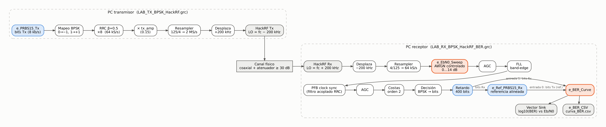
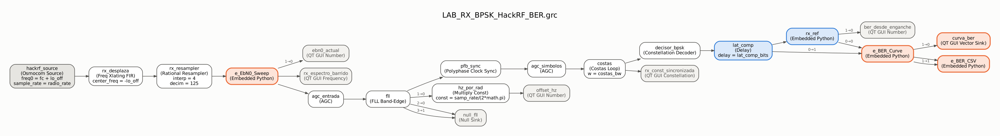
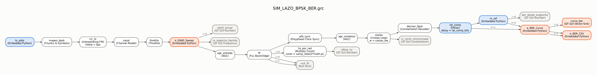
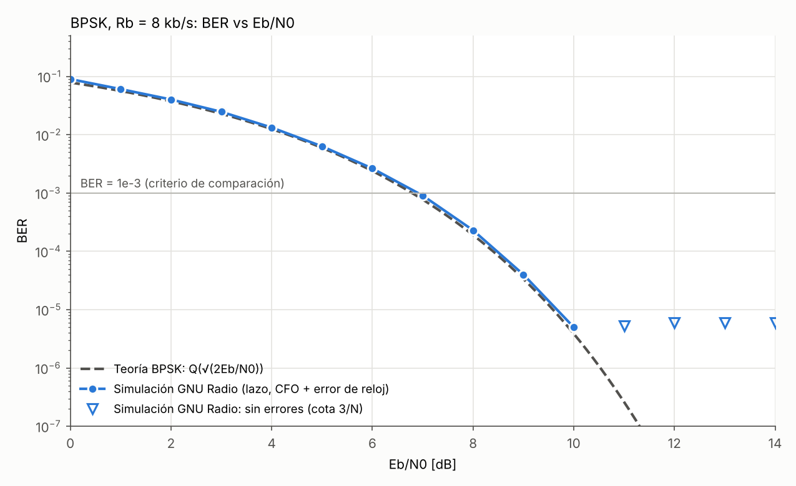
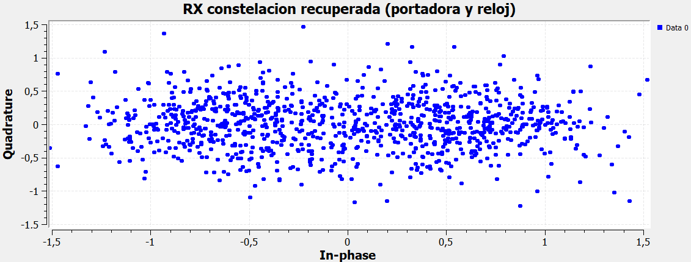
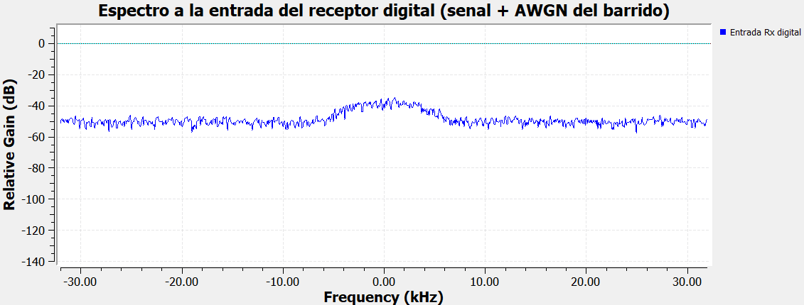
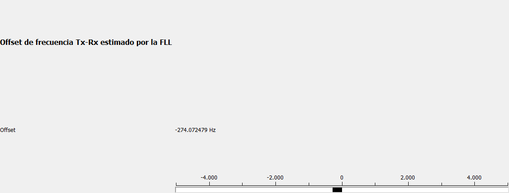
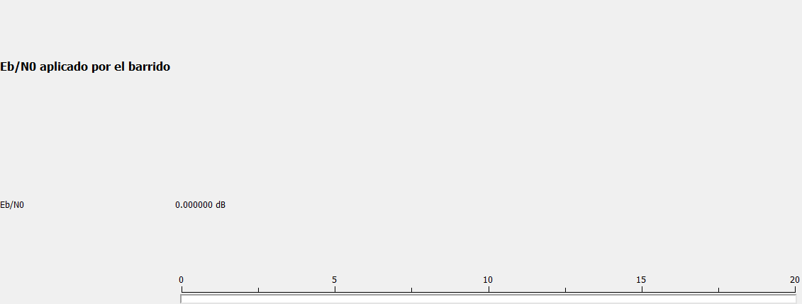

<script>MathJax={tex:{inlineMath:[['$','$'],['\\(','\\)']]}};</script>
<script async src="https://cdn.jsdelivr.net/npm/mathjax@3/es5/tex-chtml.js"></script>

[← Inicio](index.md) · [1. Escenario](01-escenario-beta.md) · [2. HackRF](02-hackrf.md) · **3. BER** · [Bitácora](bitacora.md)

# 3. Medición de desempeño: BER vs Eb/N0 (Fase 4)

## 3.1 Qué se mide

La señal atraviesa el transmisor digital, el HackRF Tx, el cable con atenuadores y el HackRF Rx. Después de la adaptación de tasa, `e_EbN0_Sweep` suma una cantidad **conocida** de AWGN y el receptor digital intenta recuperar los bits. `e_BER_Curve` compara esos bits con la secuencia transmitida y acumula la BER de cada valor de Eb/N0. La curva es **híbrida**: conserva las imperfecciones reales del enlace SDR (offset de frecuencia, error de reloj, ruido propio, cuantización de 8 bits) y les añade una degradación AWGN controlada.

El ruido se calcula a partir de la potencia medida antes de añadirlo:

$$E_b=\frac{P_s}{R_b},\qquad N_0=\frac{E_b}{E_b/N_0},\qquad P_n=N_0\,f_s=\frac{P_s\,f_s}{R_b\,10^{(E_b/N_0)_{dB}/10}}$$

y la referencia teórica para BPSK coherente en AWGN es

$$P_b=Q\!\left(\sqrt{2E_b/N_0}\right)=\tfrac12\,\mathrm{erfc}\!\left(\sqrt{E_b/N_0}\right),\qquad P_b=10^{-3}\ \text{en}\ 6.79\ \text{dB}.$$

## 3.2 Dónde se integró la instrumentación



```
HackRF Source → Xlating −200 kHz → Rational Resampler 4/125 → e_EbN0_Sweep → AGC → FLL → PFB Clock Sync → AGC → Costas → Decisor
                                    (2 MS/s → 64 kS/s)        (AWGN controlado)                                               │
                                                                                                  Retardo 400 bits ◄───────────┘
                                                                                                         │
                                                                    e_Ref_PRBS15_Rx (bits Tx de referencia, alineados)
                                                                         │ entrada 0                     │ entrada 1 (bits Rx)
                                                                         └──────────► e_BER_Curve ◄──────┘
                                                                                         ├─► QT GUI Vector Sink: log10(BER) vs Eb/N0
                                                                                         └─► e_BER_CSV → curva_BER.csv
```



*`LAB_RX_BPSK_HackRF_BER.grc` dibujado a partir del archivo: en naranja el instrumento del curso, en azul los bloques propios. Las etiquetas `0→0` y `0→1` sobre las flechas que llegan a `e_BER_Curve` indican la entrada 0 (referencia Tx) y la entrada 1 (bits Rx).*

- **`e_EbN0_Sweep`** va justo después del *Rational Resampler* 4/125 (la tasa ya es bb_rate = 64 kS/s) y antes de la primera AGC, es decir, en el punto donde el receptor digital recibía antes su I/Q. Su salida de Eb/N0 se muestra en un *Number Sink*.
- **`e_BER_Curve`**: entrada 0 = bits Tx de referencia; entrada 1 = bits Rx después de filtrado, sincronización, decisión y demapeo. En BPSK un símbolo es un bit, así que la decisión ya es la secuencia de bytes 0/1.
- La salida log10(BER) va al *Vector Sink* (eje X = Eb/N0, eje Y = log10 BER) y las dos salidas van a `e_BER_CSV`, que escribe `curva_BER.csv` cada 2 s en la carpeta del flujograma.

Archivos: [`LAB_RX_BPSK_HackRF_BER.grc`](https://github.com/LuisArleyM/ComII-BPSK-Telemetria-HackRF/blob/main/grc/fase4_ber/LAB_RX_BPSK_HackRF_BER.grc) (copia del receptor funcional con la instrumentación, para el laboratorio) y [`SIM_LAZO_BPSK_BER.grc`](https://github.com/LuisArleyM/ComII-BPSK-Telemetria-HackRF/blob/main/grc/fase4_ber/SIM_LAZO_BPSK_BER.grc) (el mismo receptor alimentado por un transmisor y un canal simulados, sin hardware). El transmisor del laboratorio es [`LAB_TX_BPSK_HackRF.grc`](https://github.com/LuisArleyM/ComII-BPSK-Telemetria-HackRF/blob/main/grc/fase3_hackrf/LAB_TX_BPSK_HackRF.grc), sin cambios: ya transmite la PRBS-15.

## 3.3 Parámetros utilizados

| Parámetro | Valor | Justificación |
|---|---|---|
| Rb | **8000 b/s** | BPSK: Rb = Rs·log2(2) = Rs = 8 kbaud |
| bb_rate | **64 000 S/s** | Tasa I/Q a la entrada del receptor digital (Rs·Sps), después de 2 MS/s × 4/125 |
| EbN0_min / EbN0_max / EbN0_step | 0 dB / 14 dB / 1 dB | 15 puntos, valores iniciales de la guía |
| bits_por_punto | 100 000 | ≈ 100 errores por visita a BER = 10⁻³ |
| bits_guardia | 1000 | Tiempo para que AGC, FLL, reloj y Costas se reacomoden tras cada cambio de ruido |
| delay_bits | **0** | El retardo Tx→Rx lo estima automáticamente `e_Ref_PRBS15_Rx` (sección 3.4) |
| update_every | 1000 | Actualización de la curva cada 1000 bits |
| lat_comp_bits | **400** | Retardo igual en ambas ramas del medidor para compensar la latencia del receptor (sección 3.6) |
| fll_bw / costas_bw | 2π/2500 / 2π/200 | Anchos de banda de los lazos del receptor, elegidos con el estudio de la sección 3.8 |
| seed (barrido) | 2026 | Ruido reproducible |
| Secuencia de prueba | PRBS-15, x¹⁵ + x¹⁴ + 1, semilla 0x7FFF | Igual en Tx y Rx |

Los parámetros del barrido son idénticos en `e_EbN0_Sweep` y `e_BER_Curve` porque ambos toman las mismas variables del flujograma. Un barrido completo dura 15 × 101 000 / 8000 ≈ 189 s (3.2 min); la curva se refina en cada repetición.

## 3.4 Bits de referencia con Tx y Rx en computadores distintos

El Tx y el Rx corren en computadores diferentes, así que el Rx no tiene una derivación directa de los bits Tx. Seguimos la recomendación de la guía: ambos extremos conocen la **misma secuencia repetible**, una PRBS-15 de periodo 32 767 bits generada por el bloque [`e_PRBS15_Tx`](https://github.com/LuisArleyM/ComII-BPSK-Telemetria-HackRF/blob/main/grc/instrumentacion/e_PRBS15_Tx.py) en el Tx. Esa es la derivación de los bits antes de la modulación (paso 6 de la guía).

El problema es que cada flujograma arranca cuando alguien pulsa *Execute*, así que el retardo entre la secuencia local del Rx y los bits recibidos cambia **en cada ejecución**: un `delay_bits` calibrado una vez no sirve la siguiente. Además el lazo de Costas puede engancharse con 180° de error y entregar todos los bits invertidos. Para eso escribimos [`e_Ref_PRBS15_Rx`](https://github.com/LuisArleyM/ComII-BPSK-Telemetria-HackRF/blob/main/grc/instrumentacion/e_Ref_PRBS15_Rx.py), que hace automáticamente el trabajo de `delay_bits`:

1. **Adquisición.** Toma los últimos W = 256 bits recibidos y calcula su correlación circular con la PRBS completa mediante FFT. El máximo de |correlación| da la fase de la secuencia (el retardo) y su signo da la polaridad. Acepta el enganche si hay como máximo 25 % de discrepancias: la probabilidad de un falso enganche es ≈ 10⁻¹¹ y la de no enganchar con una BER real de 15 % es ≈ 10⁻⁵.
2. **Seguimiento.** A partir de ahí genera la referencia continuando la fase hallada, **sin mirar los bits recibidos**: los errores se cuentan, no se corrigen.
3. **Saltos de 180°.** A Eb/N0 bajos el lazo de Costas puede saltar media vuelta y desde ese instante todos los bits salen invertidos. Si en los últimos 32 bits hay al menos 75 % de discrepancias (con una BER real de 15 % eso tiene probabilidad ≈ 5·10⁻¹⁴), invierte la polaridad de la referencia. Cada salto cuesta ≈ 20 bits erróneos, que **sí** se cuentan. Es el comportamiento de un receptor real que resuelve la ambigüedad con una secuencia conocida; en una prueba con 5 saltos sintéticos los detectó todos, sin falsos, con ≈ 20 errores adicionales por salto.
4. **Pérdida de alineación.** Si en una ventana de 512 bits la discrepancia supera 35 % con la polaridad ya corregida (se ganó o se perdió un bit en la recuperación de reloj), vuelve a adquirir. Mientras tanto la referencia sigue la fase anterior, de modo que esos bits cuentan como errores reales.
5. Antes del primer enganche entrega el complemento de lo recibido (BER = 1): si no hay señal, la curva lo muestra en lugar de aparentar BER = 0.

El bloque es 1:1 (cada bit que entra produce un bit de referencia), así que no altera el conteo de `e_BER_Curve` ni su segmentación. Al engancharse imprime el retardo equivalente y la polaridad, por ejemplo:

```
[RX-REF] Enganche #1: 37/256 discrepancias en la ventana, polaridad normal, retardo equivalente = 18 bits (mod 32767).
```

En un único flujograma (Tx y Rx arrancando juntos), ese retardo de **18 bits** es exactamente el `delay_bits` que habría que poner si se tomara la derivación directa de los bits Tx.

## 3.5 Verificación de la alineación en condición limpia

Antes de aceptar una curva, la guía exige demostrar BER ≈ 0 sin ruido añadido:

- **Simulación (GNU Radio 3.10.12):** mismo transmisor y receptor (FLL 2π/2500, Costas 2π/200), canal con CFO de 300 Hz, error de reloj de 10 ppm y desfase de 0.7 rad, **sin** `e_EbN0_Sweep`. Resultado: enganche en el bit 1024 (mientras convergen la FLL y el lazo de Costas), polaridad normal, retardo de 18 bits y **0 errores en 198 882 bits**. Como no hubo errores no afirmamos BER = 0, sino BER < 3/N = 1.5·10⁻⁵ con 95 % de confianza ([`condicion_limpia.txt`](https://github.com/LuisArleyM/ComII-BPSK-Telemetria-HackRF/blob/main/resultados/simulacion/condicion_limpia.txt)).
- **Hardware:** se hace con [`LAB_RX_BPSK_HackRF.grc`](https://github.com/LuisArleyM/ComII-BPSK-Telemetria-HackRF/blob/main/grc/fase3_hackrf/LAB_RX_BPSK_HackRF.grc), que no tiene barrido y muestra en pantalla "BER en condición limpia (desde el enganche)". *Pendiente de la sesión de laboratorio (ver 3.9).*

## 3.6 Problemas encontrados en la instrumentación y cómo se resolvieron

### a) Dos incompatibilidades de los bloques suministrados con GNU Radio 3.10

Al compilar con `grcc` (GNU Radio 3.10.12.0, radioconda, Windows):

```
>>> Error: Connection between rx_ref(0) and e_BER_Curve(0) could not be made
Param - Code(_source_code): No python block class found in code
Param - Code(_source_code): Can't create an instance of your block: name '__file__' is not defined
```

| Bloque | Causa | Corrección mínima |
|---|---|---|
| `e_BER_Curve` | Hereda de `gr.sync_decimator`, que en GNU Radio 3.10 es la clase C++; GRC solo reconoce como bloque Python las pasarelas `gr.sync_block`, `gr.decim_block`, `gr.interp_block` y `gr.basic_block` | `class blk(gr.decim_block)` y `gr.decim_block.__init__(...)`. Misma firma (`name, in_sig, out_sig, decim`) y misma relación de 1000 entradas por salida. **El algoritmo de conteo no se tocó** |
| `e_BER_CSV` | Usa `Path(__file__)`, pero GRC ejecuta el código del bloque sin `__file__` al cargarlo | `try/except NameError` que usa la carpeta de trabajo solo en esa evaluación; al ejecutar, el CSV queda junto al flujograma como estaba previsto |

`e_EbN0_Sweep` se usa sin ninguna modificación. Los cambios están comentados dentro de cada archivo.

### b) Artefacto de segmentación por la latencia del receptor

`e_EbN0_Sweep` cambia el nivel de ruido según el índice de **muestra** que entra al receptor, y `e_BER_Curve` asigna cada bit a un punto según el índice del **bit** que sale del receptor. El receptor tiene latencia (filtros, PFB, decisión: 18 bits en nuestro caso), así que los últimos bits de cada segmento del medidor en realidad recibieron el ruido del **siguiente** punto del barrido. La guarda de 1000 bits protege el inicio de cada segmento, pero no el final.

El caso grave es el punto de 14 dB: lo sigue el de 0 dB (el barrido vuelve a empezar), así que unos 18 bits por barrido con BER ≈ 8 % se cuentan como si fueran de 14 dB. Eso crea un **piso falso de BER ≈ 10⁻⁵** donde la teoría da 7·10⁻¹³.

**Corrección sin tocar el medidor:** un *Delay* de `lat_comp_bits = 400` bits en ambas entradas de `e_BER_Curve` (se antepone a los bits Rx antes de generar la referencia, así que las dos ramas quedan desplazadas igual y alineadas entre sí). Así los segmentos del medidor empiezan 400 − 18 ≈ 380 bits antes que los del barrido: el final de cada segmento queda dentro de su propio nivel de ruido y el inicio cae en la guarda de 1000 bits, que aún deja ≈ 600 bits de estabilización.

Validación numérica con los bloques reales y un receptor ideal ([`scripts/validar_instrumento_numpy.py`](https://github.com/LuisArleyM/ComII-BPSK-Telemetria-HackRF/blob/main/scripts/validar_instrumento_numpy.py), 2 barridos):

| Eb/N0 | Teoría | Sin compensación (errores / bits) | Con `lat_comp_bits = 400` |
|---|---|---|---|
| 13 dB | 1.3·10⁻¹⁰ | 0 / 200 000 | 0 / 200 000 |
| 14 dB | 6.8·10⁻¹³ | **3 / 200 000 (1.5·10⁻⁵, falso)** | 0 / 200 000 |

**Límite de validez por error de reloj.** Si los relojes de Tx y Rx difieren en Δ ppm, el índice de bit del medidor se corre respecto al del barrido Δ·10⁻⁶·1.515·10⁶ bits por barrido (≈ 15 bits por barrido con 10 ppm). Con ≈ 380 bits de margen al final y ≈ 600 al inicio, la medición es válida durante unos 25 barridos (≈ 80 min) con 10 ppm. El offset que muestra la FLL permite estimar Δ: Δ[ppm] = offset[Hz] / 960.

## 3.7 Validación del instrumento (receptor ideal)

Con un receptor ideal (filtro acoplado RRC y muestreo en el instante óptimo), un canal con giro de 180° y los bloques `e_EbN0_Sweep`, `e_Ref_PRBS15_Rx` y `e_BER_Curve` reales, la BER medida coincide con la teoría en todo el rango. Esto demuestra que el ruido del barrido está bien calibrado para Rb = 8 kb/s y bb_rate = 64 kS/s, y que el alineador resuelve la inversión de polaridad:

| Eb/N0 [dB] | 0 | 2 | 4 | 6 | 7 | 8 | 9 | 10 |
|---|---|---|---|---|---|---|---|---|
| Teoría | 7.86·10⁻² | 3.75·10⁻² | 1.25·10⁻² | 2.39·10⁻³ | 7.73·10⁻⁴ | 1.91·10⁻⁴ | 3.36·10⁻⁵ | 3.87·10⁻⁶ |
| Medido (200 000 bits por punto) | 7.97·10⁻² | 3.66·10⁻² | 1.24·10⁻² | 2.38·10⁻³ | 7.20·10⁻⁴ | 1.90·10⁻⁴ | 3.0·10⁻⁵ | 5·10⁻⁶ |

Una lección lateral de esta validación: un error de muestreo de una sola muestra (1/8 de símbolo) degradaba la curva ≈ 1 dB, lo que muestra lo sensible que es la BER a la recuperación de reloj.

## 3.8 Curva simulada con el receptor completo (GNU Radio)

[`SIM_LAZO_BPSK_BER.grc`](https://github.com/LuisArleyM/ComII-BPSK-Telemetria-HackRF/blob/main/grc/fase4_ber/SIM_LAZO_BPSK_BER.grc) reemplaza los dos HackRF por un canal simulado con las imperfecciones típicas de un enlace SDR, **sin ruido propio**: offset de frecuencia de 300 Hz, error de reloj de 10 ppm y desfase de 0.7 rad. El receptor y la instrumentación son exactamente los del laboratorio. Es nuestra **curva de simulación** para la comparación a BER = 10⁻³ que pide el proyecto.



### Ajuste de los lazos del receptor

La primera simulación (FLL 2π/400, Costas 2π/100) dio una curva bastante peor que la teoría a Eb/N0 bajos: BER de 35 % en 0 dB. La consola mostraba cientos de re-enganches con polaridad alternada: el lazo de Costas daba **saltos de 180°**. Después de incorporar el seguimiento de polaridad (sección 3.4) la BER en 0 dB bajó a 22 %, pero aún hubo 3201 saltos en 9 millones de bits. Para encontrar la causa medimos la BER real (incluidos los saltos) para 9 combinaciones de anchos de banda, con 150 000 bits por punto ([`estudio_lazos.csv`](https://github.com/LuisArleyM/ComII-BPSK-Telemetria-HackRF/blob/main/resultados/simulacion/estudio_lazos.csv)):

| FLL | Costas | BER 0 dB | BER 2 dB | BER 4 dB | BER 6 dB | Saltos de 180° |
|---|---|---|---|---|---|---|
| 2π/400 | 2π/50 | 2.36·10⁻¹ | 8.27·10⁻² | 2.08·10⁻² | 3.57·10⁻³ | 523 |
| 2π/400 | 2π/100 | 2.15·10⁻¹ | 7.26·10⁻² | 2.05·10⁻² | 3.46·10⁻³ | 532 |
| 2π/400 | 2π/200 | 4.18·10⁻¹ | 3.16·10⁻¹ | 2.19·10⁻¹ | 1.12·10⁻¹ | 2331 |
| 2π/1000 | 2π/50 | 1.99·10⁻¹ | 6.44·10⁻² | 1.76·10⁻² | 3.26·10⁻³ | 403 |
| 2π/1000 | 2π/100 | 9.90·10⁻² | 4.29·10⁻² | 1.44·10⁻² | 2.80·10⁻³ | 38 |
| 2π/1000 | 2π/200 | 8.70·10⁻² | 4.09·10⁻² | 1.39·10⁻² | 2.64·10⁻³ | 0 |
| 2π/2500 | 2π/50 | 2.05·10⁻¹ | 6.58·10⁻² | 1.72·10⁻² | 3.26·10⁻³ | 386 |
| 2π/2500 | 2π/100 | 9.55·10⁻² | 4.25·10⁻² | 1.43·10⁻² | 2.79·10⁻³ | 32 |
| **2π/2500** | **2π/200** | **8.39·10⁻²** | **4.02·10⁻²** | **1.36·10⁻²** | **2.63·10⁻³** | **0** |
| *Teoría* | | *7.86·10⁻²* | *3.75·10⁻²* | *1.25·10⁻²* | *2.39·10⁻³* | |

**Interpretación.** El culpable era la FLL. Con un ancho de banda grande, a Eb/N0 bajo su estimación de frecuencia "tiembla" y el lazo de Costas tiene que seguir ese temblor. Un Costas angosto no alcanza a seguirlo (fila 2π/400 – 2π/200: desastre) y uno ancho lo sigue, pero con mucho ruido de fase, y salta. Al hacer la FLL lenta (2π/2500) la frecuencia queda estable, el Costas puede ser más angosto (2π/200), su ruido de fase baja y **los saltos desaparecen**. El costo es una adquisición más lenta (enganche en el bit 1024 en lugar del 512), irrelevante con un offset estático como el de dos HackRF. Elegimos FLL 2π/2500 y Costas 2π/200; quedaron como valores por defecto de todos los receptores.

*En el laboratorio:* si el offset real entre los HackRF fuera de varios kHz y la FLL tardara demasiado en converger, se puede compensar primero con el parámetro de corrección en ppm del Osmocom Source o volver a 2π/1000, la segunda mejor opción.

### Resultado

Seis barridos completos (600 000 bits por punto, 9.1 millones de bits en total), un solo enganche y **ningún salto de 180°**.



*Curva dibujada con [`scripts/analizar_curva_BER.py`](https://github.com/LuisArleyM/ComII-BPSK-Telemetria-HackRF/blob/main/scripts/analizar_curva_BER.py) directamente desde `curva_BER_simulacion.csv`, el CSV que escribe `e_BER_CSV` durante la ejecución (sin editar), junto con la teoría. Los triángulos huecos son puntos sin errores, dibujados en la cota 3/N.*

| Eb/N0 [dB] | Errores | Bits | BER medida | BER teórica |
|---|---|---|---|---|
| 0 | 56 717 | 633 000 | 8.96·10⁻² | 7.86·10⁻² |
| 1 | 36 299 | 600 000 | 6.05·10⁻² | 5.63·10⁻² |
| 2 | 24 106 | 600 000 | 4.02·10⁻² | 3.75·10⁻² |
| 3 | 14 816 | 600 000 | 2.47·10⁻² | 2.29·10⁻² |
| 4 | 7 961 | 600 000 | 1.33·10⁻² | 1.25·10⁻² |
| 5 | 3 793 | 600 000 | 6.32·10⁻³ | 5.95·10⁻³ |
| 6 | 1 583 | 600 000 | 2.64·10⁻³ | 2.39·10⁻³ |
| 7 | 543 | 600 000 | 9.05·10⁻⁴ | 7.73·10⁻⁴ |
| 8 | 138 | 600 000 | 2.30·10⁻⁴ | 1.91·10⁻⁴ |
| 9 | 24 | 600 000 | 4.0·10⁻⁵ | 3.4·10⁻⁵ |
| 10 | 3 | 600 000 | 5·10⁻⁶ | 3.9·10⁻⁶ |
| 11–14 | 0 | 600 000 c/u | sin errores: BER < 5·10⁻⁶ | < 3·10⁻⁷ |

Datos: [`curva_BER_simulacion.csv`](https://github.com/LuisArleyM/ComII-BPSK-Telemetria-HackRF/blob/main/resultados/simulacion/curva_BER_simulacion.csv) (generado por el medidor) y [`conteos_simulacion.csv`](https://github.com/LuisArleyM/ComII-BPSK-Telemetria-HackRF/blob/main/resultados/simulacion/conteos_simulacion.csv) (errores y bits leídos de `e_BER_Curve` al final).

| Curva | Eb/N0 para BER = 10⁻³ | Pérdida respecto a la teoría |
|---|---|---|
| Teoría BPSK | 6.79 dB | — |
| **Simulación GNU Radio (receptor completo)** | **6.91 dB** | **0.12 dB** |
| Experimental HackRF | pendiente | — |

Otras gráficas de la simulación al terminar (GNU Radio):

| Constelación recuperada | Espectro a la entrada del Rx digital |
|---|---|
|  |  |
| **Offset estimado por la FLL** | **Eb/N0 que aplicaba el barrido** |
|  |  |

La FLL estima −300.8 Hz, es decir, corrige exactamente el offset de +300 Hz del canal.

## 3.9 Medición experimental con HackRF One

**Estado:** pendiente de la sesión de laboratorio. El archivo `curva_BER.csv` debe generarlo el sistema de medición con los radios y no se edita a mano, así que **no publicamos ninguna curva experimental hasta medirla**. Todo está listo para hacerlo:

1. **PC Tx:** abrir `grc/fase3_hackrf/LAB_TX_BPSK_HackRF.grc`. Dejar `noise_amp = 0`, `tx_amp = 0.15`, `tx_vga = 20` y el amplificador RF apagado. Verificar `fc` con el docente.
2. **Enlace:** cable SMA con 30–40 dB de atenuación (nunca conectar directo).
3. **PC Rx, condición limpia:** abrir `grc/fase3_hackrf/LAB_RX_BPSK_HackRF.grc`. Ajustar `rx_lna` y `rx_vga` hasta que la constelación sea limpia sin saturar. Anotar el offset de la FLL y verificar que "BER en condición limpia" sea ≈ 0 durante al menos 100 000 bits (≈ 13 s). Capturar la pantalla. **Esta es la evidencia de BER ≈ 0.**
4. **PC Rx, curva:** cerrar el anterior y abrir `grc/fase4_ber/LAB_RX_BPSK_HackRF_BER.grc` con las mismas ganancias. Dejar correr al menos 3 barridos (≈ 10 min) y verificar en la consola que haya un solo enganche y pocos o ningún salto de 180°.
5. Copiar el `curva_BER.csv` que aparece en la carpeta del flujograma a `resultados/experimental/` **sin modificarlo** y ejecutar `python scripts/analizar_curva_BER.py`, que dibuja teoría, simulación y experimento y calcula la penalización a BER = 10⁻³.
6. Criterio del proyecto: penalización experimental ≤ 2 dB respecto a la simulación a BER = 10⁻³.

**Qué esperamos y qué revisar si no se cumple.** La curva experimental debería quedar paralela a la simulada y algunas décimas de dB a la derecha. La potencia que mide `e_EbN0_Sweep` incluye el ruido propio del enlace, así que si la SNR física de base no es alta la curva se corre a la derecha y puede aparecer un piso en Eb/N0 altos. Si eso pasa: subir `tx_vga` o las ganancias de Rx sin saturar, y revisar la PSD (señal 20–30 dB sobre el piso en 64 kS/s). Si la BER no baja con Eb/N0: revisar Rb, bb_rate, el enganche (consola), saturación y el offset de la FLL.

## 3.10 Análisis de la forma de la curva

**Forma general.** La curva tiene la forma de "cascada" esperada para BPSK: la BER cae cada vez más rápido al aumentar Eb/N0, unas 1.6 décadas por cada dB entre 8 y 10 dB. Entre 3 y 10 dB queda a 0.1–0.2 dB de la teoría; a BER = 10⁻³ la pérdida de implementación es de **0.12 dB**.

**Extremo de baja Eb/N0.** En 0 dB la BER medida (8.96 %) supera a la teórica (7.86 %), equivalente a ≈ 0.5 dB. Ahí los lazos de sincronización (AGC, FLL, reloj y portadora) trabajan con muy poca SNR y su ruido de estimación se suma al del canal. Es la pérdida de implementación típica de un receptor sin pilotos.

**Extremo de alta Eb/N0.** De 11 a 14 dB no hubo ningún error en 600 000 bits por punto. No decimos que la BER sea 0: solo que es menor que 3/N = 5·10⁻⁶ con 95 % de confianza. El CSV guarda en esos puntos log10(3/N) como cota, y la gráfica los marca con triángulos huecos. Para medir BER de 10⁻⁷ o menos harían falta del orden de 10⁸ bits por punto.

**Soporte estadístico.** El error relativo de una BER estimada con k errores es ≈ 1/√k. En el punto de 7 dB (543 errores) es ±4 %, es decir ±0.02 dB sobre el Eb/N0 de cruce, así que la comparación a 10⁻³ es sólida. En 9 dB (24 errores) es ±20 % y en 10 dB (3 errores) el valor solo es indicativo.

**Comportamientos inesperados que encontramos y resolvimos:**

1. Los bloques `e_BER_Curve` y `e_BER_CSV` no cargaban en GNU Radio 3.10 (sección 3.6a).
2. Piso falso de BER ≈ 10⁻⁵ en 14 dB por la latencia del receptor frente a la segmentación del barrido (sección 3.6b).
3. Saltos de ciclo de 180° del lazo de Costas que multiplicaban la BER a Eb/N0 bajo (sección 3.8). Su causa era el ancho de banda de la FLL.

**Qué cambiará con el hardware.** `e_EbN0_Sweep` mide como potencia de "señal" todo lo que entra, incluido el ruido propio del enlace. Si ρ es la SNR física en la banda de 64 kHz y γ el Eb/N0 nominal del barrido, el Eb/N0 real es menor, y la curva experimental se correrá a la derecha en

$$\Delta[\text{dB}] = 10\log_{10}\!\left(1+\frac{1}{\rho}+\frac{\gamma\,R_b}{f_s\,\rho}\right).$$

Con γ = 6.8 dB, para ρ = 20 dB la penalización es de solo 0.07 dB, pero para ρ = 10 dB sube a 0.64 dB. Por eso conviene que la señal quede bien por encima del piso en la PSD del receptor antes de medir. A eso se suman el ruido de fase de los osciladores, la cuantización de 8 bits y el desbalance I/Q. Como la simulación queda a solo 0.12 dB de la teoría, el criterio del proyecto (≤ 2 dB de penalización experimental) deja margen para todas esas imperfecciones.

## 3.11 Conclusión

El instrumento del curso quedó integrado en una copia del receptor funcional, con `e_EbN0_Sweep` justo después de la adaptación 2 MS/s → 64 kS/s y `e_BER_Curve` comparando la PRBS-15 regenerada y alineada en el receptor con los bits decididos. La medición es válida porque: (i) con un receptor ideal el instrumento reproduce la teoría punto a punto; (ii) en condición limpia hay 0 errores en casi 200 000 bits; (iii) el alineador resuelve el retardo aleatorio entre PC y la ambigüedad de 180° sin ocultar errores; y (iv) corregimos el artefacto de latencia que inflaba la BER en 14 dB. Con los lazos ajustados, el receptor BPSK simulado tiene una pérdida de implementación de 0.12 dB a BER = 10⁻³ y ningún salto de ciclo en 9 millones de bits. Queda pendiente la medición con los dos HackRF, para la cual los flujogramas, el procedimiento y el script de comparación ya están listos.

---
[← 2. HackRF](02-hackrf.md) · [Bitácora →](bitacora.md)
