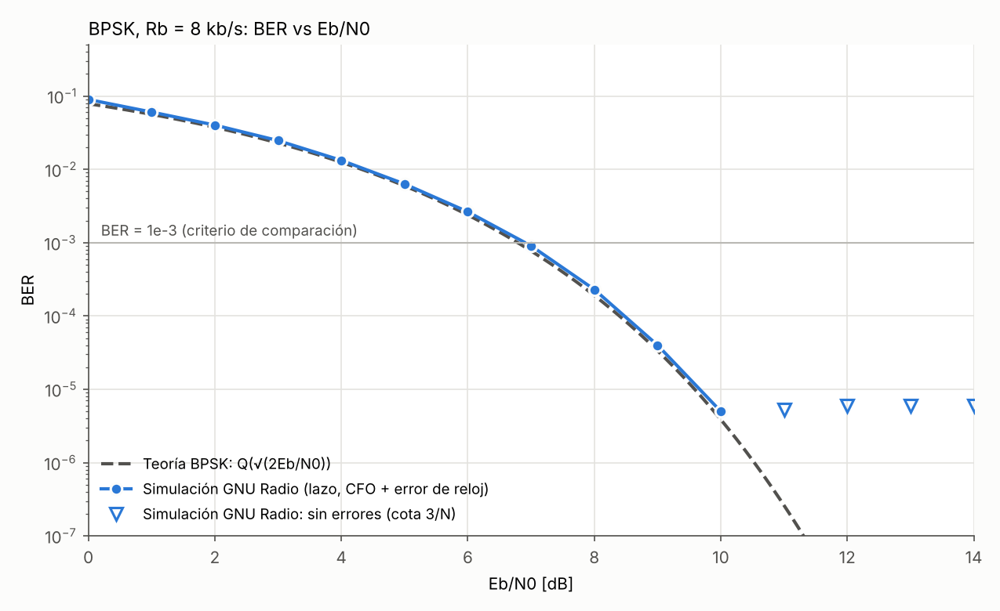
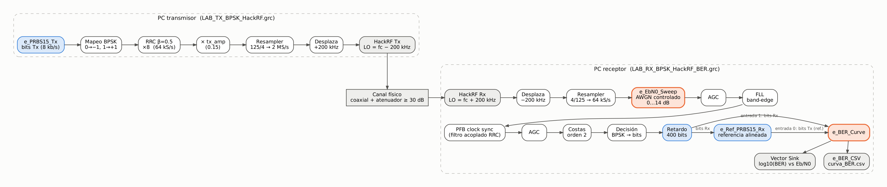

# Telemetría industrial con BPSK sobre HackRF One

**Proyecto final de Comunicaciones II (27145) — Escuela E3T, Universidad Industrial de Santander**

**Integrantes:** Luis Arley Martínez Caballero · Johan Sebastián Gómez Hernández
**Docentes:** Omar Tíjaro · Ronald Zamora

---

## De qué trata este blog

Una máquina industrial envía su telemetría de estado por un enlace digital. Lo que importa no es la velocidad sino que la señal siga siendo reconocible cuando aparecen perturbaciones eléctricas breves (escenario **S1 — telemetría industrial con perturbación impulsiva controlada**). Para ese problema elegimos **BPSK**, la modulación más robusta del curso, y recorrimos el camino completo:

| Entrada | Fase | Qué se hizo | Estado |
|---|---|---|---|
| [1. Escenario y simulación con impulsos](01-escenario-beta.md) | Proyecto beta | Ficha del escenario, GRC con impulsos 0.3 / 0.6 / 1.0, PSD, constelación, tiempo, comparación con BFSK y análisis numérico | Completo |
| [2. Del simulador al HackRF One](02-hackrf.md) | Fase 3 (Guía 3) | Transmisor y receptor BPSK con Osmocom, adaptación 64 kS/s ↔ 2 MS/s, LO desplazado, sincronización, prueba real 16-QAM con dos HackRF, preguntas de investigación | Flujogramas listos y compilados; prueba 16-QAM en el laboratorio con fotos y video |
| [3. Medición BER vs Eb/N0](03-ber.md) | Fase 4 (Guía 4) | Integración de `e_EbN0_Sweep` y `e_BER_Curve`, referencia PRBS-15 alineada en el Rx, compensación de latencia, ajuste de lazos, curva simulada y procedimiento experimental | Simulación completa; **medición con HackRF pendiente de laboratorio** |
| [Bitácora](bitacora.md) | Todas | Registro breve de lo realizado y de los problemas encontrados | En curso |





*Arquitectura final. En naranja, los bloques de instrumentación del curso (`e_EbN0_Sweep`, `e_BER_Curve`); en azul, los bloques que añadimos para que la medición sea válida con el Tx y el Rx en computadores distintos.*

## Resultados principales (hasta hoy)

- **Escenario impulsivo:** con el ruido base `noise_amp = 0.10` el enlace trabaja a Eb/N0 ≈ 29 dB, así que los impulsos dominan la degradación. En el dominio del tiempo se ven con claridad desde A = 0.6; en la PSD solo levantan el piso ≈ 0.15 / 0.6 / 1.4 dB. Un receptor con filtro acoplado los atenúa 8 veces (A/Sps) y no comete errores ni con A = 1.0, mientras que decidir con una sola muestra por símbolo da BER ≈ 7.8·10⁻³ con A = 1.0.
- **Prueba real en el laboratorio (16-QAM, dos HackRF One):** el espectro confirmó el esquema de LO desplazado (fuga del Tx en 959.8 MHz, señal en 960.0 MHz, DC del Rx en 960.2 MHz) y, en régimen, 450 tramas seguidas pasaron el CRC (187 200 bits sin errores) con EVM ≈ 4.6 %.
- **Hardware:** Rs = 8 kbaud, Rb = 8 kb/s, bb_rate = 64 kS/s, radio_rate = 2 MS/s (remuestreo 125/4), fc = 960 MHz con el LO desplazado 200 kHz para alejar la señal del pico DC del HackRF.
- **Instrumentación BER:** el instrumento del curso quedó validado: con un receptor ideal reproduce la teoría Q(√(2Eb/N0)) punto a punto. Detectamos y documentamos dos incompatibilidades de los bloques suministrados con GNU Radio 3.10 y un artefacto de segmentación causado por la latencia del receptor (BER falsa ≈ 10⁻⁵ en 14 dB), que corregimos sin tocar el algoritmo del medidor.
- **Curva BER simulada con el receptor completo (GNU Radio):** a BER = 10⁻³ queda a solo **0.12 dB de la teoría** (6.91 dB frente a 6.79 dB), sin saltos de ciclo en 9 millones de bits, tras un estudio de los anchos de banda de la FLL y del lazo de Costas.
- **Condición limpia (simulación GNU Radio):** 0 errores en 198 882 bits con CFO de 300 Hz, error de reloj de 10 ppm y desfase de 0.7 rad (BER < 1.5·10⁻⁵ con 95 % de confianza).

## Uso de herramientas de inteligencia artificial

En este proyecto usamos un asistente de IA (Claude, de Anthropic) como herramienta de apoyo, principalmente para:

- adaptar los flujogramas de laboratorio del curso a BPSK e integrar en ellos los bloques de medición BER;
- escribir bloques auxiliares en Python (fuente PRBS-15 y alineación de la referencia en el receptor) y los scripts de análisis y automatización de capturas;
- revisar el código de los bloques suministrados, lo que permitió detectar sus incompatibilidades con GNU Radio 3.10;
- organizar y redactar las entradas del blog.

El equipo definió el escenario y la modulación, hizo las sesiones de laboratorio con los HackRF One (incluida la prueba 16-QAM documentada en la fase 3), ejecutó todas las simulaciones en GNU Radio en su propio computador y es responsable de la revisión y del contenido final. Los datos numéricos publicados (archivos CSV, conteos de errores y capturas) provienen directamente de esas ejecuciones y no fueron editados.

## Estructura del repositorio

```
├── README.md                     ← resumen y enlaces
├── EJECUTAR_SIMULACIONES.bat     ← reproduce todas las simulaciones y capturas (Windows + radioconda)
├── docs/                         ← este blog (GitHub Pages) e imágenes
├── grc/
│   ├── fase2_simulacion/         ← Enlace_Beta_Impulsivo_BPSK.grc, Enlace_Beta_Impulsivo_BFSK.grc
│   ├── fase3_hackrf/             ← LAB_TX_BPSK_HackRF.grc, LAB_RX_BPSK_HackRF.grc
│   ├── clase_16qam/              ← flujogramas 16-QAM usados en la prueba de laboratorio
│   ├── fase4_ber/                ← LAB_RX_BPSK_HackRF_BER.grc, SIM_LAZO_BPSK_BER.grc
│   └── instrumentacion/          ← bloques del curso y bloques propios (PRBS-15)
├── resultados/
│   ├── simulacion/               ← curva_BER_simulacion.csv, condición limpia, análisis impulsivo
│   └── experimental/             ← aquí va curva_BER.csv generado con los HackRF
└── scripts/                      ← análisis en Python y automatización de capturas
```

## Cómo reproducir

1. Instalar [radioconda](https://github.com/ryanvolz/radioconda) (GNU Radio 3.10). Probado con GNU Radio 3.10.12.0 y Python 3.12.9 en Windows.
2. Simulaciones y capturas: doble clic en `EJECUTAR_SIMULACIONES.bat` (o `python scripts/ejecutar_y_capturar.py` desde *Radioconda Prompt*).
3. Laboratorio: abrir `grc/fase3_hackrf/LAB_TX_BPSK_HackRF.grc` en el PC transmisor y `grc/fase4_ber/LAB_RX_BPSK_HackRF_BER.grc` en el receptor, con cable coaxial y ≥ 30 dB de atenuación.
4. Análisis de la curva: `python scripts/analizar_curva_BER.py`.
